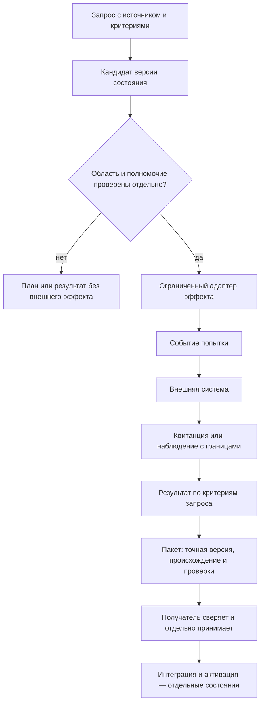

# Рабочая архитектура FUM/FUMA

## Статус и цель

Это целевая, технологически независимая модель рабочего контура FUM/FUMA. Она отделяет устойчивые сущности и их отношения от Git, файловой системы, GitHub, Codex и текущей структуры FUMA. Это архитектурное описание, а не утверждение, что такой единый runtime уже реализован или принят.

Модель продолжает внутреннее представление FUM как связанной памяти и сети узлов, а также разделение трассы, наблюдения и преобразования между наблюдателями. Источники и их точные версии приведены в конце. Формулировки этого документа — проектное предложение FUM; они не претендуют на внешний научный консенсус.

## Одно логическое пространство памяти

В целевой модели FUM — одно логическое пространство памяти и связей. Оно может храниться и выполняться на нескольких физических основаниях. Git, локальные файлы, сервис GitHub, сеанс Codex и хранилища FUMA предоставляют адреса, версии, события или наблюдения; сами по себе они не становятся отдельными логическими «памятями FUM».

Адаптер сопоставляет объект своего основания с логической сущностью, сохраняет исходный адрес и происхождение и явно отмечает потерю или преобразование данных. Поэтому одна логическая версия может иметь несколько физических представлений, а несколько представлений могут ссылаться на один узел. Физическая копия, индекс или проекция не создаёт новую идентичность узла.

Логическая память не требует единственного файла или базы данных. Она требует устойчивых идентификаторов, точных версий, происхождения, отношений между записями и возможности проверить, что конкретный адаптер видел или передал.

## Роли Fuma, FUMA и внешних исполнителей

**Fuma** — персональный ИИ-агент пользователя и координатор работы. У него есть собственная логическая идентичность, область полномочий, версия личной памяти и история принятых решений. Он может поручать работу своим подагентам и подключённым внешним агентам.

**FUMA** — язык и среда исполнения структурирующих операторов FUM. FUMA задаёт способ описывать и запускать повторяемые вычисления; это не другое имя персонального агента Fuma. Существующие пакеты и legacy-среда FUMA служат исходным материалом для первого воплощения целевого контура.

**Внешний агент** — отдельный исполнитель в среде своего провайдера. Его идентификатор, сессия, память, события и результаты принадлежат этой среде. Подключение через адаптер не объединяет его состояние с личной памятью Fuma и не наследует полномочия Fuma автоматически.

### Поручение внешнему агенту

Передаваемый через адаптер пакет связывает точный запрос, входные версии и критерии результата с логическим адресом получателя, ограниченной областью и явно разрешёнными действиями. Он также задаёт идентификатор связи поручения Fuma с задачей или сессией провайдера, условия наблюдения событий и способ возврата результата. Адаптер переводит этот пакет в интерфейс провайдера, сохраняя исходное поручение и точное соответствие идентификаторов; технически доступное действие не становится разрешённым без полномочия.

Адаптер наблюдает только объявленные события и сохраняет их источник, идентификатор или последовательность у провайдера, время, охват и способ получения. События «поручение принято», «исполнение начато», «ход сообщён» и «задача завершена» описывают состояние провайдера, но сами по себе не доказывают, что заявленный результат получен или внешний эффект состоялся.

При возврате адаптер передаёт точный результат и доступные свидетельства, исходные идентификаторы провайдера, ссылки или хэши выходных материалов, заявленные проверки и неразрешённые поля. Fuma сверяет их с первоначальными критериями и отдельно наблюдает нужный внешний эффект. После этого принятый результат получает собственную версию в памяти Fuma с происхождением от поручения и наблюдений провайдера. Версия личной памяти Fuma не подменяет текущее состояние сессии или хранилища провайдера; если провайдерское состояние недоступно или противоречиво, оно остаётся `UNKNOWN` до нового наблюдения.

## Основные сущности

Термины ниже задают границы целевой модели. Они не требуют немедленно вводить одноимённые типы в коде или хранилище.

| Сущность | Роль в модели | Не следует смешивать с |
| --- | --- | --- |
| **Узел** | Логическая единица FUM с устойчивым идентификатором, собственными состояниями и связями. Узлом может быть человек, агент, приложение, сервис, среда или составная сеть. | Запущенным процессом, веткой Git, папкой, аккаунтом или адресом. |
| **Адрес** | Способ найти узел, версию, сеанс или ресурс в конкретном основании: endpoint, Git-ref, путь, URL, ID сеанса. Адрес может измениться и может быть временным. | Идентичностью узла или разрешением действовать. |
| **Область** | Граница рассматриваемых объектов, данных, времени и операций конкретной работы: что входит в задачу и на какие ресурсы она распространяется. | Полномочием. Наличие объекта в области не даёт права его менять. |
| **Полномочие** | Ограниченное право субъекта выполнить названную операцию над названными ресурсами при заданных условиях и сроке действия. Выдача, принятие, наблюдение и отзыв полномочия — разные факты. | Адресом, назначением исполнителя, текстом запроса или технической доступностью инструмента. |
| **Версия состояния** | Неизменяемое закрепление содержания узла или логической записи с идентификатором, родительскими версиями, происхождением и ссылками на данные. Текущая вершина — отдельный, потенциально изменяемый указатель. | Событием, HEAD/ref или внешним эффектом. |
| **Событие** | Запись о том, что произошло в контуре: запрос принят, полномочие выдано, команда вызвана, наблюдение снято, результат получен или пакет передан. Событие связывается с субъектом, временем, входами и причинными предшественниками. | Снимком состояния или доказательством того, что внешний эффект действительно наступил. |
| **Запрос** | Намерение человека, агента или сервиса с источником, желаемым результатом, запрошенной областью и критериями завершения. | Полномочием, выполнением, результатом или фактом изменения внешней системы. |
| **Наблюдение** | Ограниченное свидетельство о состоянии источника, полученное указанным наблюдателем в указанное время и в пределах указанного охвата. Сохраняются источник, метод, версия адаптера и ссылка или хэш исходных данных. | Полным или вечным снимком мира. Ненаблюдавшееся состояние остаётся неизвестным. |
| **Эффект** | Фактическое изменение состояния вне логической памяти FUM, например изменение в сервисе, файловом хранилище или устройстве. | Намерением, подготовленным планом или вызовом API. Вызов фиксирует попытку; эффект требует отдельного подтверждения. |
| **Результат** | Вывод о выполнении запроса по заранее определённым критериям и связанным с ними свидетельствам. Область вывода не может быть шире области доказательств. | Наличием файла, успешным кодом процесса, доставкой или приёмкой без соответствующего свидетельства. |
| **Передача** | Переход точного результата или версии от отправителя к получателю с манифестом, происхождением, областью, проверками и состоянием владения. | Сообщением о намерении передать или одним лишь появлением ссылки у отправителя. |
| **Экземпляр исполнения** | Конкретный запуск узла, связанный с версией состояния, запросом, средой, адресом сеанса, набором инструментов и наблюдаемыми параметрами выполнения. Запрошенные модель и усилие сохраняются отдельно от фактически подтверждённых. | Идентичностью логического узла или доказательством того, что сеанс всё ещё активен. |

Событие может привести к новой версии состояния, но это разные записи. В частности, событие «вызов начат» не равно событию «внешнее изменение подтверждено». Запрос может породить план или кандидата версии без эффекта во внешнем мире.

В действующей Git-практике закреплённый commit может быть точной версией состояния и результата работы узла. В общей модели commit — конкретное представление такой версии; другой технологический адаптер может закрепить тот же логический результат иначе.

Область и полномочие проверяются независимо: первая описывает, что рассматривается; второе — какие операции разрешены. Адаптер не расширяет полномочия субъекта и не превращает доступный endpoint в разрешённый маршрут.

## Цикл работы и передача результата

Если исход вызова нельзя установить, он остаётся `UNKNOWN` до нового независимого наблюдения. Неизвестный исход не становится ни успехом, ни доказательством отсутствия эффекта. Повторный эффект требует отдельного решения после сверки состояния.

Передача имеет собственный проверяемый цикл: подготовить точный артефакт и манифест; отправить; считать доставку; получить подтверждение получателя; сверить полученную версию; принять или отклонить по объявленным критериям. Принятие, слияние или интеграция и активация — разные исходы. Например, закрытая задача или слитый PR являются состояниями внешнего сервиса; сами по себе они не доказывают, что другой получатель принял и применил нужную версию.

## Проектный принцип: наблюдать чаще, изменять адресно

Для целевой системы FUM принимается проектная эвристика «много наблюдать, мало менять». Это способ строить устойчивый контур, а не доказанный универсальный закон и не запрет на своевременное выполнение поручений.

- Наблюдение фиксируется как небольшое версионированное событие с источником, временем, охватом и ресурсной границей. При повторных опросах предпочтительны новые данные и изменения с момента известной версии; каждый раз копировать весь доступный мир не требуется.
- Решение отделено от побочного эффекта: оно читает закреплённый запрос, наблюдения, состояние, область и полномочия и выдаёт кандидата версии или план действия. Само принятие решения не меняет внешний источник.
- Если действующий запрос уже задаёт достаточную цель и полномочие, система может выполнить его автономно в собственной области. Эвристика снижает лишнее наблюдение и побочные изменения, но не добавляет ожидание неподтверждённого согласования.
- Действие выполняет отдельный ограниченный адаптер. Затем система читает результат в целевом источнике и связывает его с критериями запроса. Недостаточное или противоречивое свидетельство оставляет исход `UNKNOWN`.

Так наблюдение остаётся более дешёвым и частым способом обновить память, а внешнее изменение — отдельным адресным переходом с собственным полномочием и проверкой. Их частота и ресурсная цена задаются политикой конкретной системы и измеряются на конкретных рабочих нагрузках, а не выводятся из этой эвристики как общая константа.

### Программирование повторяемой работы

Ещё одна проектная максима FUM: «Каждый агент программист, а задача программиста — отобрать у него работу». Агент сначала выполняет разрешённую работу и сохраняет её трассу, затем отмечает повторяемый участок, который можно передать программе или оператору. Перед созданием нового средства он проверяет, есть ли уже пригодная программа: достаточное средство переиспользуется, отдельный дубликат не требуется.

Если подходящего средства нет, агент может оформить повторяемый участок как версионируемую программу или оператор с явными входами, границей области, полномочиями и критериями результата. Исходная трасса связывает запрос, наблюдавшиеся входы, вызовы модели, выделенный повторяемый фрагмент, версию программы, её проверки и результат исполнения. На конкретной нагрузке измеряются качество результата, ресурсные затраты и фактическая потребность в вызовах модели. Проверенная программа получает только адресно переданную часть работы; агент возвращается к новым задачам, сохраняя наблюдение за исходами, которые автоматизация не может надёжно установить.

Это проектный цикл, а не требование автоматизировать любую работу и не свидетельство, что такой цикл уже реализован в FUMA. Передача автоматизации не расширяет исходную область или полномочия; неустановленный исход остаётся `UNKNOWN`, а связь с первичной трассой и проверкой сохраняется.

## Технологические основания как адаптеры

| Основание | Что оно может представлять | Что нельзя вывести из этого одного |
| --- | --- | --- |
| **Git** | Commit и tree закрепляют версии содержимого и происхождение; branch/ref указывает на выбранную вершину; blob хранит байты конкретного файла. | Ref не является идентичностью узла или полномочием. Commit подтверждает существование Git-версии, но не внешний эффект, доставку, принятие или запуск агента. |
| **Файловая система** | Путь разрешает адрес; байты, режим и хэш описывают материализацию; метаданные источника связывают её с версией. | Путь не является стабильной идентичностью. Разрешение ОС на запись не тождественно полномочию FUM. Наличие файла не доказывает, что описанное им действие выполнено. |
| **GitHub** | Issue может отображать запрос; комментарии, review, PR и проверки дают события и наблюдения своего сервиса; API позволяет делать попытки эффекта. | Текст Issue не выдаёт полномочие сам по себе. Успешный API-ответ или состояние `closed`/`merged` не заменяют повторного чтения точного объекта и отдельных критериев приёмки. |
| **Codex и другие провайдеры** | Идентификатор задачи или сессии адресует исполнение в среде провайдера; события и возвращённые материалы дают ограниченные наблюдения для адаптера внешнего исполнителя. | Адрес провайдера не является идентичностью Fuma. Состояние личной памяти Fuma не доказывает состояние сессии провайдера; завершение задачи провайдера не доказывает внешний эффект. |
| **FUMA: язык и среда** | Структурирующие операторы, существующие пакеты и runtime-данные служат вычислительным слоем и исходным материалом для первого воплощения FUMA из legacy. | FUMA как язык и среда не является персональным агентом Fuma. Наличие пакетов не доказывает единый runtime или завершённую загрузку логического состояния. |
| **Внешняя среда исполнителя** | Содержит собственные адреса, версии, события, результаты и состояние исполнения подключённого агента; адаптер связывает выбранные наблюдения и точные результаты с поручением Fuma. | Состояние провайдера не становится частью памяти Fuma без явного наблюдения и принятия. Подключение не расширяет область или полномочия и не доказывает приёмку Fuma. |

Каждый адаптер фиксирует: собственный тип адреса и объекта; идентификатор логического узла и версии, если сопоставление установлено; исходный хэш или квитанцию; время и способ наблюдения; границу охвата; преобразования и потери; неизвестные поля; проверку обратного чтения. Если связь нельзя доказать, адаптер сохраняет «не установлено», а не подбирает идентичность по похожему имени или пути.

Пример входа FUMA: прочитать доступный файл шрифта OTF/TTF, сохранить его точное происхождение и лицензионные сведения, затем выполнить операторное вычисление над закреплённым входом. Чтение и вычисление образуют отдельные версии/события; полученное представление остаётся кандидатом результата, а запись или установка шрифта требует отдельного полномочия. Для этого примера приоритетен CC0, но расширение файла не доказывает лицензию. Это иллюстрация общего контура, не реализация оператора шрифтов.

## Загрузка FUMA из legacy и переход к целевой модели

Пользовательская постановка задаёт порядок: первое воплощение FUMA загружается из существующего legacy FUM и развивается поверх него. Целевой контур поэтому начинается с реального состояния прежней системы, а не с предположения о пустой независимой базе. Это направление миграции; само по себе оно не описывает готовый загрузчик.

| Фаза | Целевое действие | Граница завершения фазы |
| --- | --- | --- |
| **1. Закрепить источник** | Зафиксировать точный снимок кода, конфигурации и доступных данных legacy; разделить отслеживаемые исходники, пользовательское состояние и неизвестные источники. | Есть воспроизводимая ссылка на исходные объекты, хэши и границу чтения; оригиналы не переписываются. |
| **2. Загрузить без записи** | Создать адаптер чтения и таблицу сопоставления legacy-адресов с логическими узлами и версиями. Сохранить непреобразуемые поля и причины неизвестности. | Повторное чтение одного снимка даёт те же связи; потеря и неполнота видимы. Внешние эффекты отключены. |
| **3. Построить логическое представление** | Читать память и историю через адаптеры и собирать единый вид узлов, версий, событий, запросов и наблюдений. Сверять его с legacy-представлением. | Различия классифицированы; исходные байты и адреса доступны для обратного перехода к источнику. |
| **4. Запустить первое воплощение FUMA** | Привязать каждый запуск к узлу, версии, запросу, адресу среды, полномочиям и параметрам исполнения. FUMA пока использует legacy как источник состояния и среду воплощения. | Фактические параметры запуска и происхождение читаются независимо от желаемых; запись во внешние системы не выводится из самого факта запуска. |
| **5. Включать эффекты адресно** | Разрешать каждому адаптеру отдельные типы эффектов после явного связывания полномочия и области. Для каждой попытки сохранять идентификатор, точный вход, исход и последующее чтение результата. | Для каждого эффекта есть терминальная квитанция или независимое наблюдение; `UNKNOWN` остаётся открытым до сверки. |
| **6. Передавать и менять основание** | Передавать точные принятые версии между адаптерами и получателями. Переносить один вид состояния за раз; сохранять прежнее основание, пока не установлена непрерывность. | Получатель прочитал ту же версию, подтвердил критерии и собственное состояние. Удаление или отключение legacy — отдельное решение после этой границы. |

Такой переход допускает длительную совместную работу старых и новых адаптеров. Дублирование байтов не означает расхождение логической памяти, если обе копии ссылаются на одну версию и их происхождение доказано. Напротив, общий путь или одинаковое имя не делают две записи одной версией.

## Что подтверждено в выбранном снимке, а что остаётся целью

Состав источников закреплён commit `ac78d0b410395358797663dcc028150938839f06`, tree `970680cf267361cefb9299750899ad4dc81f67c7`. В этом снимке README FUMA описывает четыре самостоятельных SwiftPM-пакета и приложение для macOS; контейнер наблюдений уже подключён к CLI-сценарию операторов приложения, остальные пакеты требуют отдельной интеграции. Единый пакет назван целевым переносом, а не текущим расположением.

README macOS FUMA описывает существующие `FUM_RUNTIME_ROOT` и `FUM_MEMORY_ROOT` и прямо указывает, что автоматического переноса прежних данных нет. Эти документы подтверждают состав и заявленные границы данной реализации в закреплённом снимке. Они **не** подтверждают запуск целевого логического загрузчика, единый FUMA-runtime, принятие описанной модели или завершение миграции. Для каждого такого утверждения нужна отдельная версия исходника и результат наблюдаемой проверки.

## Происхождение источников

Каждая ссылка ниже закреплена к одному commit, чтобы содержание не зависело от подвижной ветки `master`. SHA-1 — OID Git blob; SHA-256 вычислен по байтам файла из указанного commit.

| Источник из снимка | Git blob | SHA-256 |
| --- | --- | --- |
| [Архитектура FUM](https://github.com/fum-lab/fum/blob/ac78d0b410395358797663dcc028150938839f06/Документация/22-архитектура-FUM.md) | `57c9053c66bf07010eeae66e25ccb95b122bed07` | `8665f7707e52e0b54f1a047bb2811f20d8269c78fd4da303ec3da1b71679cba2` |
| [Модель памяти FUM](https://github.com/fum-lab/fum/blob/ac78d0b410395358797663dcc028150938839f06/Документация/01-модель-памяти-FUM.md) | `8f660205e183961eff5b600a5c840f40c4956833` | `bcdc0a63225f04d59df0da2ecf79f58ea1f2e98111639f6cb0ec36c078c86380` |
| [Формат трассы агентского цикла](https://github.com/fum-lab/fum/blob/ac78d0b410395358797663dcc028150938839f06/Документация/37-минимальный-формат-трассы-исполняемого-агентского-цикла.md) | `53376aab6783e6a4ceb83baf157587efad153e1c` | `e29be3f4f3002d35ea59081a6ff8f37ccacdac1809809e7e029ca87d8bf4992f` |
| [Преобразования между наблюдателями](https://github.com/fum-lab/fum/blob/ac78d0b410395358797663dcc028150938839f06/Документация/38-минимальный-формат-преобразования-между-наблюдателями-FUM.md) | `e11e7ea5d87db7fbf4f3a6b89795a42d90877670` | `7f536fa72953e0e4af06a601914070f1b9f92168affdbe1f49f177df3642c03b` |
| [Git-инфраструктура эволюционных цепочек](https://github.com/fum-lab/fum/blob/ac78d0b410395358797663dcc028150938839f06/Документация/20-Git-инфраструктура-эволюционных-цепочек-FUM.md) | `11cf765de73f78770a2c7c2898394156d4203d10` | `27c5ae9385ea0311aab03d541dd63952131002eecf89e713c87691bb7dacc779` |
| [Публичный upstream и форки памяти](https://github.com/fum-lab/fum/blob/ac78d0b410395358797663dcc028150938839f06/Документация/27-публичный-upstream-и-форки-памяти.md) | `f55f173f8579620cef6fafe6ee271b647dcb8c5c` | `37d419656fe74a0df4c7a7f801912163e9852f4dffe5fc0f56aabb1c0a8b8d55` |
| [Состав исходников FUMA](https://github.com/fum-lab/fum/blob/ac78d0b410395358797663dcc028150938839f06/Приложения/FUMA/README.md) | `c8edb0ed896c6af3367a99f59efcff477fda2942` | `69ff292ec2c75cc7ad2853690eb1bdcb9f1018eaa86d14d506dd5e4a1f21ad8e` |
| [Приложение FUMA для macOS](https://github.com/fum-lab/fum/blob/ac78d0b410395358797663dcc028150938839f06/Приложения/FUMA/macOS/README.md) | `eab3b6e6d76821dc22c6e21267123b5fa9c65e79` | `44f0d9f66f02fec243fc6bdbf130819b742348e0abd0ef8de8ae7aee6a9a596a` |

Существующие документы показывают отдельные проработанные слои; объединение их в перечисленную здесь модель — авторский целевой синтез на основании задачи и указанных источников. Точная схема сериализации, интерфейсы адаптеров, алгоритм миграции и автоматические критерии приёмки здесь не зафиксированы: для них нужны отдельные решения и проверяемая реализация.

## Источники требований

- [Исходная постановка документационного узла](postanovka.json), SHA-256 `1dd774e5b818e7400e560f1eced78a43f6f9ab92e04e6921b35dc9017e8e5fbc`, закреплённая на commit `0250fe352314180287bc011254af1129f61d0e00`.
- Запрос человека из сессии ROOT `01a07d3d-d376-7ad2-aafc-67e4c25a67eb`; дословная формулировка сохранена в [журнале сессии](../Журнал/2026-10-30_19-02-40_MSK_зафиксировать-архитектуру-fum/запрос.md).

<!-- FUM-MD-RECENCY:BEGIN -->
<!-- last-content-edit: 2026-10-30 19:47:19 MSK -->
<!-- content-sha256: sha256:8c6cbfe0965d8104524b6756e4e7d598c974669eb6c1b7b1a1383c76b10bc308 -->
<!-- FUM-MD-RECENCY:END -->
