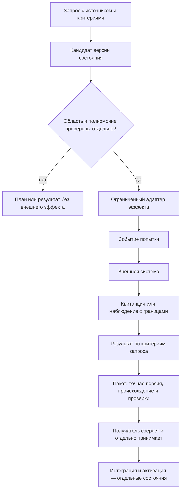

# Рабочая архитектура FUM/FUMA

## Статус и цель

Это целевая, технологически независимая модель рабочего контура FUM/FUMA. Она отделяет устойчивые сущности и их отношения от Git, файловой системы, GitHub, Codex и текущей структуры FUMA. Это архитектурное описание, а не утверждение, что такой единый runtime уже реализован или принят.

Модель продолжает внутреннее представление FUM как связанной памяти и сети узлов, а также разделение трассы, наблюдения и преобразования между наблюдателями. Источники и их точные версии приведены в конце. Формулировки этого документа — проектное предложение FUM; они не претендуют на внешний научный консенсус.

## Одно логическое пространство памяти

В целевой модели FUM — одно логическое пространство памяти и связей. Оно может храниться и выполняться на нескольких физических основаниях. Git, локальные файлы, сервис GitHub, сеанс Codex и хранилища FUMA предоставляют адреса, версии, события или наблюдения; сами по себе они не становятся отдельными логическими «памятями FUM».

Адаптер сопоставляет объект своего основания с логической сущностью, сохраняет исходный адрес и происхождение и явно отмечает потерю или преобразование данных. Поэтому одна логическая версия может иметь несколько физических представлений, а несколько представлений могут ссылаться на один узел. Физическая копия, индекс или проекция не создаёт новую идентичность узла.

Логическая память не требует единственного файла или базы данных. Она требует устойчивых идентификаторов, точных версий, происхождения, отношений между записями и возможности проверить, что конкретный адаптер видел или передал.

## Роли Fuma, FUMA и внешних исполнителей

**Fuma** — персональный ИИ-агент пользователя и координатор работы. У него есть собственная логическая идентичность, область полномочий, версия личной памяти и история принятых решений. Он может поручать работу своим подагентам и подключённым внешним агентам.

**FUMA** — язык и среда исполнения структурирующих операторов FUM. FUMA задаёт способ описывать и запускать повторяемые вычисления; это не другое имя персонального агента Fuma. Существующие пакеты и legacy-среда FUMA служат исходным материалом для первого воплощения целевого контура.

**Внешний агент** — отдельный исполнитель в среде своего провайдера. Его идентификатор, сессия, память, события и результаты принадлежат этой среде. Подключение через адаптер не объединяет его состояние с личной памятью Fuma и не наследует полномочия Fuma автоматически.

### Поручение внешнему агенту

Передаваемый через адаптер пакет связывает точный запрос, входные версии и критерии результата с логическим адресом получателя, ограниченной областью и явно разрешёнными действиями. Он также задаёт идентификатор связи поручения Fuma с задачей или сессией провайдера, условия наблюдения событий и способ возврата результата. Адаптер переводит этот пакет в интерфейс провайдера, сохраняя исходное поручение и точное соответствие идентификаторов; технически доступное действие не становится разрешённым без полномочия.

Адаптер наблюдает только объявленные события и сохраняет их источник, идентификатор или последовательность у провайдера, время, охват и способ получения. События «поручение принято», «исполнение начато», «ход сообщён» и «задача завершена» описывают состояние провайдера, но сами по себе не доказывают, что заявленный результат получен или внешний эффект состоялся.

При возврате адаптер передаёт точный результат и доступные свидетельства, исходные идентификаторы провайдера, ссылки или хэши выходных материалов, заявленные проверки и неразрешённые поля. Fuma сверяет их с первоначальными критериями и отдельно наблюдает нужный внешний эффект. После этого принятый результат получает собственную версию в памяти Fuma с происхождением от поручения и наблюдений провайдера. Версия личной памяти Fuma не подменяет текущее состояние сессии или хранилища провайдера; если провайдерское состояние недоступно или противоречиво, оно остаётся `UNKNOWN` до нового наблюдения.

## Основные сущности

Термины ниже задают границы целевой модели. Они не требуют немедленно вводить одноимённые типы в коде или хранилище.

| Сущность | Роль в модели | Не следует смешивать с |
| --- | --- | --- |
| **Узел** | Логическая единица FUM с устойчивым идентификатором, собственными состояниями и связями. Узлом может быть человек, агент, приложение, сервис, среда или составная сеть. | Запущенным процессом, веткой Git, папкой, аккаунтом или адресом. |
| **Адрес** | Способ найти узел, версию, сеанс или ресурс в конкретном основании: endpoint, Git-ref, путь, URL, ID сеанса. Адрес может измениться и может быть временным. | Идентичностью узла или разрешением действовать. |
| **Область** | Граница рассматриваемых объектов, данных, времени и операций конкретной работы: что входит в задачу и на какие ресурсы она распространяется. | Полномочием. Наличие объекта в области не даёт права его менять. |
| **Полномочие** | Ограниченное право субъекта выполнить названную операцию над названными ресурсами при заданных условиях и сроке действия. Выдача, принятие, наблюдение и отзыв полномочия — разные факты. | Адресом, назначением исполнителя, текстом запроса или технической доступностью инструмента. |
| **Версия состояния** | Неизменяемое закрепление содержания узла или логической записи с идентификатором, родительскими версиями, происхождением и ссылками на данные. Текущая вершина — отдельный, потенциально изменяемый указатель. | Событием, HEAD/ref или внешним эффектом. |
| **Событие** | Запись о том, что произошло в контуре: запрос принят, полномочие выдано, команда вызвана, наблюдение снято, результат получен или пакет передан. Событие связывается с субъектом, временем, входами и причинными предшественниками. | Снимком состояния или доказательством того, что внешний эффект действительно наступил. |
| **Запрос** | Намерение человека, агента или сервиса с источником, желаемым результатом, запрошенной областью и критериями завершения. | Полномочием, выполнением, результатом или фактом изменения внешней системы. |
| **Наблюдение** | Ограниченное свидетельство о состоянии источника, полученное указанным наблюдателем в указанное время и в пределах указанного охвата. Сохраняются источник, метод, версия адаптера и ссылка или хэш исходных данных. | Полным или вечным снимком мира. Ненаблюдавшееся состояние остаётся неизвестным. |
| **Эффект** | Фактическое изменение состояния вне логической памяти FUM, например изменение в сервисе, файловом хранилище или устройстве. | Намерением, подготовленным планом или вызовом API. Вызов фиксирует попытку; эффект требует отдельного подтверждения. |
| **Результат** | Вывод о выполнении запроса по заранее определённым критериям и связанным с ними свидетельствам. Область вывода не может быть шире области доказательств. | Наличием файла, успешным кодом процесса, доставкой или приёмкой без соответствующего свидетельства. |
| **Передача** | Переход точного результата или версии от отправителя к получателю с манифестом, происхождением, областью, проверками и состоянием владения. | Сообщением о намерении передать или одним лишь появлением ссылки у отправителя. |
| **Экземпляр исполнения** | Конкретный запуск узла, связанный с версией состояния, запросом, средой, адресом сеанса, набором инструментов и наблюдаемыми параметрами выполнения. Запрошенные модель и усилие сохраняются отдельно от фактически подтверждённых. | Идентичностью логического узла или доказательством того, что сеанс всё ещё активен. |

Событие может привести к новой версии состояния, но это разные записи. В частности, событие «вызов начат» не равно событию «внешнее изменение подтверждено». Запрос может породить план или кандидата версии без эффекта во внешнем мире.

В действующей Git-практике закреплённый commit может быть точной версией состояния и результата работы узла. В общей модели commit — конкретное представление такой версии; другой технологический адаптер может закрепить тот же логический результат иначе.

Область и полномочие проверяются независимо: первая описывает, что рассматривается; второе — какие операции разрешены. Адаптер не расширяет полномочия субъекта и не превращает доступный endpoint в разрешённый маршрут.

### Адрес агента, памяти и checkout

Целевой логический адрес задаётся иерархией `repo/fork/path`: устойчивая идентичность репозитория; идентичность линии форка с явной связью на родительский репозиторий; нормализованный путь внутри дерева форка. Каталог агента или его памяти привязывается к такому адресу, а не к произвольному локальному пути. Само имя каталога, аккаунта или ветки не создаёт и не меняет идентичность узла.

Для точного адреса состояния эта иерархия связывается с неизменяемой версией: идентичность repo/fork, точный commit и канонический путь внутри его дерева задают две согласованные координаты — положение в истории Git и положение в файловой памяти. Ref выбирает версию во времени, но может переместиться; путь без версии не определяет историческое содержимое. Это Git-представление логического адреса, а не замена идентичности узла или адресов других оснований.

При согласованном переносе каталогов, веток и областей памяти соответствия адресов и ссылки обновляются вместе, а прежние адреса сохраняются как исторические. Связанные чертежи включают исходники, схемы, контракты, закреплённые версии зависимостей и инструментальной цепочки, рецепты, проверки и происхождение. Их сохранение позволяет воспроизводить и изменять соответствующую часть системы. Синхронизация адресов является целевым инвариантом; наличие этого описания не подтверждает выполненную миграцию.

Git-ветка — изменяемый указатель с полным `refs/...` внутри заданного repo/fork; она выбирает текущую версию, но не заменяет адрес. Worktree — физическая материализация версии и области записи: сохраняются его физический корень, регистрация worktree и общий Git-каталог, ref, `HEAD`, tree, индекс и назначенный писатель. Перемещение локального корня или переименование ветки меняет привязку материализации, а не логический адрес; такой переход требует отдельного плана и чтения точного состояния до и после.

Связь с исполнением фиксирует корневой Codex-Thread-ID, реальный идентификатор сессии/App, логический адрес памяти, физический worktree и область полномочий. Идентификаторы не выводятся из похожих имён папок. При восстановлении читатель заново проверяет физический корень, регистрацию worktree, origin/upstream, полный ref, `HEAD`/tree/index и фактическую сессию/App, затем сравнивает их с закреплённым манифестом адреса и области записи. Только совпавшие значения восстанавливают прежнюю привязку; дрейф, неполная идентификация или неоднозначное владение остаются `UNKNOWN` и запрещают запись до отдельной сверки.

Исключения к общей иерархии сохраняются как явные версионированные правила с основанием, точной областью и владельцем; миграция не молча нормализует их. Чужие активные worktree и ветки не переименовываются. Любая их перестановка требует отдельного полномочия, подтверждённого прекращения писателя и проверяемого плана перехода. Это проектный контракт, а не описание уже реализованного обнаружения или восстановления.

Проверка каждого нового состояния включает саму адресную привязку: родитель закрепляет точные адреса дочерних узлов и их полномочия, а квитанция ребёнка возвращает подтверждённые логический адрес и физическую материализацию. Изменение ветки, корня worktree, session/App или области записи создаёт новое проверяемое состояние привязки; оно не может тихо унаследовать старую квитанцию.

## Цикл работы и передача результата

Если исход вызова нельзя установить, он остаётся `UNKNOWN` до нового независимого наблюдения. Неизвестный исход не становится ни успехом, ни доказательством отсутствия эффекта. Повторный эффект требует отдельного решения после сверки состояния.

Передача имеет собственный проверяемый цикл: подготовить точный артефакт и манифест; отправить; считать доставку; получить подтверждение получателя; сверить полученную версию; принять или отклонить по объявленным критериям. Принятие, слияние или интеграция и активация — разные исходы. Например, закрытая задача или слитый PR являются состояниями внешнего сервиса; сами по себе они не доказывают, что другой получатель принял и применил нужную версию.

## Рекурсивная проверка нового состояния

Целевое требование: каждое новое состояние checkout должно проверяться самоприменением и самотрансляцией на каждом уровне вложенности. Checkout здесь — физическая материализация логического состояния; путь сам по себе не задаёт идентичность узла. Проверка связывает узел, его неизменяемую версию и конечное замыкание входов.

### Манифест и самоприменение

Каждый проверяемый узел или пакет получает версионированный манифест. Он закрепляет устойчивый идентификатор узла и точную версию; исходные байты и версии исходников; компилятор, toolchain и зависимости; входы, исключения и границы чтения; область возможных эффектов и ресурсные пределы; версии проверяемого преобразователя и проверяющей программы; формат ожидаемых выходов. Git commit/tree может задавать эти версии в одном адаптере, но не становится обязательным идентификатором для остальных оснований.

Проверяемая версия применяет к своему точному пакету описанную в манифесте проверку и при необходимости транслирует её в исполняемое представление. Она выдаёт точные выходы и квитанцию, связанную с манифестом, входами, версиями инструментов и результатом. Это подтверждает только то, что данная версия произвела такой выход и такую квитанцию; самоописание, успешный код процесса или наличие сгенерированного проверяющего не доказывают корректность.

Принятие выполняет отдельная ранее принятая версия проверяющего. Она независимо сверяет фактические байты и версии входов, границы, инструментальную цепочку, выходы и квитанцию. Кандидат не может сам утвердить свою проверяющую версию. Новая версия проверяющего допускается к следующему поколению только после такой проверки предыдущей принятой версией. Так самоприменение проверяет собственное построение, а независимая приёмка сохраняет основание доверия вне изменяемого кандидата.

### Вложенность, результаты и предел остановки

Каждый родитель закрепляет конечный состав непосредственных дочерних узлов и точные версии каждого дочернего входа. Дочерний узел возвращает квитанцию, связанную с его версией и входами; родитель проверяет её и включает ссылку на проверяемый дочерний результат в собственную квитанцию. Корень принимает результат только для замкнутого состава: пропущенный, изменившийся или неизвестный дочерний узел оставляет общий итог неполным. Родитель передаёт ребёнку манифест, границу и версию проверяющего вниз, а результат и причину отказа или неизвестности — обратно по цепочке.

Вложенный вызов обходится по конечному графу пар «идентификатор узла — неизменяемая версия». Повтор пары не запускает бесконечную рекурсию; циклическая ссылка, отсутствующий узел, устаревший допуск или исчерпание объявленных ограничений глубины, объёма и времени завершают проверку отказом либо `UNKNOWN`. Незавершённая или неизвестная попытка не превращается в успех и не даёт разрешения вслепую повторить внешний эффект. Предыдущую квитанцию можно переиспользовать только при точном совпадении версии узла, транзитивных входов и проверяющей версии.

### Воспроизводимость и начальная опора

Для повторного запуска фиксируются точные входы, версии проверяющего и преобразователя, toolchain, зависимости, параметры и условия среды. При одинаковом замкнутом входе ожидается одинаковый проверяемый результат; расхождение сохраняется как наблюдение, а не скрывается выбором удобного запуска. Динамические зависимости и внешние источники должны быть закреплены отдельными версиями или объявлены неизвестными.

До появления независимо принятого FUMA-проверяющего начальная опора остаётся вне проверяемого кандидата. Предлагаемый переход начинается с точного Git-снимка и закреплённого Swift toolchain, затем использует небольшой независимый проверяющий контур, который сверяет состав и байты источников и выход нового кандидата. Git подтверждает идентичность закреплённых байтов, но не семантическую корректность; корректность начальной опоры также требует отдельного основания. Только после проверки этим контуром первая версия FUMA может проверять следующую версию. Описание bootstrap не утверждает, что FUMA уже является доверенным проверяющим или что такая цепочка сейчас исполняется.

### Применение к переносу каталогов

Перенос каталога должен быть описан неизменяемым планом: точные версии источника и назначения, сопоставление путей, ожидаемые байты, режимы, символические ссылки и связи, а также правила коллизий имён и Unicode-нормализации. Независимый проверяющий сначала сверяет план, затем фактический результат с тем же входом и манифестом; сам мигратор проверяется на собственном закреплённом составе, а повторное чтение результата воспроизводит ту же проверку. При частичном применении сохраняются выполненные изменения и точка остановки; до сверки исхода состояние остаётся `UNKNOWN`, повторный перенос вслепую не разрешается.

Путь каталога при переносе меняется, логический идентификатор узла остаётся прежним. Новое поколение манифеста связывает старое и новое расположение и проверяет, что все заявленные дочерние узлы и ссылки вошли в результат. В изученном FUMA-снимке есть автоматизация структуры папок с планированием, переносом и проверкой, однако отдельная принятая версия, которая независимо проверяет сам мигратор и рекурсивно замыкает его собственный пакет, не подтверждена. Узкая проверка равенства байтов Markdown не доказывает общий механизм самопроверки checkout.

### Открытые решения перед исполнением

Независимый архитектурный обзор выделил три открытых вопроса целевой спецификации. Это не доказанные дефекты работающей реализации и не автоматическое разрешение на запуск эффектов.

1. **Полномочия при дальнейшей передаче.** Нужно определить, является ли дочерний допуск подмножеством родительского по операциям, ресурсам, сроку и бюджету; требуется ли отдельное разрешение на дальнейшее делегирование; как отзыв распространяется по уже выданным дочерним поручениям.
2. **Владение текущей версией.** Для нескольких оснований требуется определить единственного владельца или условие продвижения текущего указателя и явный исход конкурирующих обновлений: отказ, ручное разрешение или версия с несколькими родителями. Это вопрос переносимой семантики; он не включает исторический CAS или автоматическую запись.
3. **Переход с legacy.** Требуется закрепить курсор исходного снимка, способ догнать и сверить последующие изменения, владельца записи на каждой фазе, проверку чтения после передачи писателя и условие отключения прежнего основания.

Эти решения должны быть увязаны с рекурсивной проверкой до соответствующих многоступенчатых делегирований, параллельной записи или переключения с legacy. До их отдельной проверки это целевой контракт, а не описание уже принятого runtime.

## Проектный принцип: наблюдать чаще, изменять адресно

Для целевой системы FUM принимается проектная эвристика «много наблюдать, мало менять». Это способ строить устойчивый контур, а не доказанный универсальный закон и не запрет на своевременное выполнение поручений.

- Наблюдение фиксируется как небольшое версионированное событие с источником, временем, охватом и ресурсной границей. При повторных опросах предпочтительны новые данные и изменения с момента известной версии; каждый раз копировать весь доступный мир не требуется.
- Решение отделено от побочного эффекта: оно читает закреплённый запрос, наблюдения, состояние, область и полномочия и выдаёт кандидата версии или план действия. Само принятие решения не меняет внешний источник.
- Если действующий запрос уже задаёт достаточную цель и полномочие, система может выполнить его автономно в собственной области. Эвристика снижает лишнее наблюдение и побочные изменения, но не добавляет ожидание неподтверждённого согласования.
- Действие выполняет отдельный ограниченный адаптер. Затем система читает результат в целевом источнике и связывает его с критериями запроса. Недостаточное или противоречивое свидетельство оставляет исход `UNKNOWN`.

Так наблюдение остаётся более дешёвым и частым способом обновить память, а внешнее изменение — отдельным адресным переходом с собственным полномочием и проверкой. Их частота и ресурсная цена задаются политикой конкретной системы и измеряются на конкретных рабочих нагрузках, а не выводятся из этой эвристики как общая константа.

### Программирование повторяемой работы

Ещё одна проектная максима FUM: «Каждый агент программист, а задача программиста — отобрать у него работу». Агент сначала выполняет разрешённую работу и сохраняет её трассу, затем отмечает повторяемый участок, который можно передать программе или оператору. Перед созданием нового средства он проверяет, есть ли уже пригодная программа: достаточное средство переиспользуется, отдельный дубликат не требуется.

Если подходящего средства нет, агент может оформить повторяемый участок как версионируемую программу или оператор с явными входами, границей области, полномочиями и критериями результата. Исходная трасса связывает запрос, наблюдавшиеся входы, вызовы модели, выделенный повторяемый фрагмент, версию программы, её проверки и результат исполнения. На конкретной нагрузке измеряются качество результата, ресурсные затраты и фактическая потребность в вызовах модели. Проверенная программа получает только адресно переданную часть работы; агент возвращается к новым задачам, сохраняя наблюдение за исходами, которые автоматизация не может надёжно установить.

Это проектный цикл, а не требование автоматизировать любую работу и не свидетельство, что такой цикл уже реализован в FUMA. Передача автоматизации не расширяет исходную область или полномочия; неустановленный исход остаётся `UNKNOWN`, а связь с первичной трассой и проверкой сохраняется.

### Общая машина и активность сети

Агенты строят общую машину: повторяемая функция подагента оформляется как проверяемая версионируемая программа или подсистема на Swift и FUMA с собственными входами, наблюдениями, действиями, исходами и контрольной точкой. Общий контракт применим к подагенту, агенту, машине и форку: он связывает свежесть наблюдений, желаемый режим, бюджет, версии сигналов и правил, план действий, происхождение исходов и условия передачи. Родитель управляет собственными непосредственными детьми и бюджетом; владелец выбирает шаги в пределах порученных цели и полномочий.

Наблюдение, обработка сигналов и реакция предусматриваются в адаптерах и операторах FUMA, а исполнение — в Swift runtime. Сигналы, чувствительности, политики и внутренние контракты делегирования версионируются и отбираются по опыту и проверяемым критериям с возможностью отката. Параллелизм повышается по мере появления готовой независимой полезной работы и ресурсов; снижение сохраняет незавершённое состояние через drain и контрольную точку. Свежесть, ограниченный срок решения и гистерезис ограничивают колебания. Аналогия с клетками и нейромедиаторами помогает описать обратную связь и не подтверждает физиологическую теорию.

Целевое размещение исполняющей среды — `fuma/` от корня репозитория; существующие компоненты предполагается использовать и переносить без второго интерпретатора или временного отдельного контроллера. В закреплённом ниже снимке реализация расположена в `Приложения/FUMA`; это описание не устанавливает, что перенос, адаптеры сигналов или замкнутое автоматическое управление сетью уже выполнены. Первый ограниченный срез должен связать наблюдения, рекомендуемый режим, бюджет, свежесть и неизвестность с планом для владельца; готовый план сам по себе не подтверждает применение.

## Технологические основания как адаптеры

| Основание | Что оно может представлять | Что нельзя вывести из этого одного |
| --- | --- | --- |
| **Git** | Commit и tree закрепляют версии содержимого и происхождение; branch/ref указывает на выбранную вершину; blob хранит байты конкретного файла. | Ref не является идентичностью узла или полномочием. Commit подтверждает существование Git-версии, но не внешний эффект, доставку, принятие или запуск агента. |
| **Файловая система** | Путь разрешает адрес; байты, режим и хэш описывают материализацию; метаданные источника связывают её с версией. | Путь не является стабильной идентичностью. Разрешение ОС на запись не тождественно полномочию FUM. Наличие файла не доказывает, что описанное им действие выполнено. |
| **GitHub** | Issue может отображать запрос; комментарии, review, PR и проверки дают события и наблюдения своего сервиса; API позволяет делать попытки эффекта. | Текст Issue не выдаёт полномочие сам по себе. Успешный API-ответ или состояние `closed`/`merged` не заменяют повторного чтения точного объекта и отдельных критериев приёмки. |
| **Codex и другие провайдеры** | Идентификатор задачи или сессии адресует исполнение в среде провайдера; события и возвращённые материалы дают ограниченные наблюдения для адаптера внешнего исполнителя. | Адрес провайдера не является идентичностью Fuma. Состояние личной памяти Fuma не доказывает состояние сессии провайдера; завершение задачи провайдера не доказывает внешний эффект. |
| **FUMA: язык и среда** | Структурирующие операторы, существующие пакеты и runtime-данные служат вычислительным слоем и исходным материалом для первого воплощения FUMA из legacy. | FUMA как язык и среда не является персональным агентом Fuma. Наличие пакетов не доказывает единый runtime или завершённую загрузку логического состояния. |
| **Внешняя среда исполнителя** | Содержит собственные адреса, версии, события, результаты и состояние исполнения подключённого агента; адаптер связывает выбранные наблюдения и точные результаты с поручением Fuma. | Состояние провайдера не становится частью памяти Fuma без явного наблюдения и принятия. Подключение не расширяет область или полномочия и не доказывает приёмку Fuma. |

Каждый адаптер фиксирует: собственный тип адреса и объекта; идентификатор логического узла и версии, если сопоставление установлено; исходный хэш или квитанцию; время и способ наблюдения; границу охвата; преобразования и потери; неизвестные поля; проверку обратного чтения. Если связь нельзя доказать, адаптер сохраняет «не установлено», а не подбирает идентичность по похожему имени или пути.

Пример входа FUMA: выбрать файл шрифта OTF/TTF по точному источнику и подтверждённой лицензии, сохранить исходные байты и происхождение, затем выполнить операторное вычисление над закреплённым входом. Расширение файла не доказывает лицензию; целевой выбор предпочитает CC0 при наличии подтверждающего первичного свидетельства.

### Шрифтовой тракт через операторы FUMA

Первый прототипный источник — [Synthax Regular TTF](https://github.com/sevavar/synthax/blob/131f5dbcf129fb8a26c3a7f52ccb2f085c1c98b3/Synthax-Regular/Synthax-Regular.ttf), commit `131f5dbcf129fb8a26c3a7f52ccb2f085c1c98b3`, Git blob `65b1d33aba5099bb9c995fdc697af24a1e1c7b0c`, SHA-256 `11d5ad87547c00e771dcf3d666b14f36ebc383f7c21f95c9b9201b3536d01d4a`, размер 61 592 байта. [Файл лицензии](https://github.com/sevavar/synthax/blob/131f5dbcf129fb8a26c3a7f52ccb2f085c1c98b3/LICENSE) того же commit — Git blob `0e259d42c996742e9e3cba14c677129b2c1b6311`, CC0 1.0 Universal. Репозиторий описывает шрифт как моноширинный с латиницей и кириллицей. Это стартовый прототип, а не окончательный визуальный выбор.

Сверка точных байтов подтвердила TTF-сигнатуру, 447 глифов, печатный ASCII и кириллицу `U+0400–U+045F`, включая `ё` (`U+0451`). В `cmap` отсутствуют `↑` (`U+2191`) и `↓` (`U+2193`). Это проверка состава кодовых точек, не проверка читаемости или окончательного визуального качества.

Целевое состояние разделяет неизменяемые исходные байты, источник и лицензию и производную версионную модель шрифта FUMA. Типизированная модель хранит таблицу Unicode `cmap`, контуры, метрики и стиль; пользователь или агент может интерактивно редактировать её и расширять на лету новыми глифами. Каждое событие вызывает чистый оператор `входная модель + событие → новая модель`; предыдущая версия и оригинальные байты сохраняются, а новая версия обновляет последующий результат рендеринга. Трасса связывает событие, входной хэш, версию оператора, контекст, изменённые глифы, способ генерации и решение пользователя или агента. Отмена обещается только там, где у операции определено обратное действие. Статический рендер готовой модели не заменяет контракт событийного редактирования и обновления.

Генератор глифов FUMA получает явный символ Unicode и контекст, анализирует контуры, метрики и стиль закреплённой модели и предлагает редактируемые варианты. Операторные проверки сопоставляют Unicode-символ с глифом, выявляют коллизии отображения и метрик и проверяют сочетания и shaping. Пользователь или агент выбирает и исправляет вариант; принятое изменение записывается новой версией модели со способом генерации и происхождением. Начальный ограниченный пилот — отсутствующие стрелки `↑`/`↓` для нотации Раскина. Он не обещает автоматического корректного покрытия всего Unicode; незнакомый символ сохраняет явный fallback и не выдаётся за сгенерированный глиф.

Целевая последовательность: точные исходные байты → операторы разбора и версия модели FUMA → событие добавления/редактирования глифа → кандидатные глифы и проверки → пользовательский выбор → новая версия модели → операторы композиции текста и геометрии → адаптер поверхности и графических команд Metal либо другого API. Разбор таблиц, shaping/композиция, размещение текста, геометрия и правила отрисовки принадлежат операторам FUMA; платформенный адаптер не подменяет их системным font API. SwiftUI `.system` остаётся временной опорой.

Поэтапная реализация профильного владельца должна включить: (1) закреплённую загрузку исходных байтов/лицензии и проверку хэшей и `cmap`; (2) типизированную версионную модель и чистые операторы событий с тестами неизменности оригинала, происхождения, воспроизводимого повтора и предусмотренной отмены; (3) редактируемый генератор и пилот `U+2191`/`U+2193` с тестами `cmap`, метрик, коллизий и текстовых сочетаний/shaping и отдельным визуальным просмотром человеком; (4) операторную геометрию и Metal-рендер, затем другие адаптеры с платформенными проверками. Эти пункты задают будущую работу с кодом FUMA и тестами, а не текущую реализацию.

Шрифтовой тракт и генератор остаются проектной целью. Наличие исходного файла и локальная инвентаризация его байтов не подтверждают FUMA-парсер, редактируемую модель, генерацию глифов, операторный shaping/рендеринг или готовый платформенный графический адаптер.

## Загрузка FUMA из legacy и переход к целевой модели

Пользовательская постановка задаёт порядок: первое воплощение FUMA загружается из существующего legacy FUM и развивается поверх него. Целевой контур поэтому начинается с реального состояния прежней системы, а не с предположения о пустой независимой базе. Это направление миграции; само по себе оно не описывает готовый загрузчик.

| Фаза | Целевое действие | Граница завершения фазы |
| --- | --- | --- |
| **1. Закрепить источник** | Зафиксировать точный снимок кода, конфигурации и доступных данных legacy; разделить отслеживаемые исходники, пользовательское состояние и неизвестные источники. | Есть воспроизводимая ссылка на исходные объекты, хэши и границу чтения; оригиналы не переписываются. |
| **2. Загрузить без записи** | Создать адаптер чтения и таблицу сопоставления legacy-адресов с логическими узлами и версиями. Сохранить непреобразуемые поля и причины неизвестности. | Повторное чтение одного снимка даёт те же связи; потеря и неполнота видимы. Внешние эффекты отключены. |
| **3. Построить логическое представление** | Читать память и историю через адаптеры и собирать единый вид узлов, версий, событий, запросов и наблюдений. Сверять его с legacy-представлением. | Различия классифицированы; исходные байты и адреса доступны для обратного перехода к источнику. |
| **4. Запустить первое воплощение FUMA** | Привязать каждый запуск к узлу, версии, запросу, адресу среды, полномочиям и параметрам исполнения. FUMA пока использует legacy как источник состояния и среду воплощения. | Фактические параметры запуска и происхождение читаются независимо от желаемых; запись во внешние системы не выводится из самого факта запуска. |
| **5. Включать эффекты адресно** | Разрешать каждому адаптеру отдельные типы эффектов после явного связывания полномочия и области. Для каждой попытки сохранять идентификатор, точный вход, исход и последующее чтение результата. | Для каждого эффекта есть терминальная квитанция или независимое наблюдение; `UNKNOWN` остаётся открытым до сверки. |
| **6. Передавать и менять основание** | Передавать точные принятые версии между адаптерами и получателями. Переносить один вид состояния за раз; сохранять прежнее основание, пока не установлена непрерывность. | Получатель прочитал ту же версию, подтвердил критерии и собственное состояние. Удаление или отключение legacy — отдельное решение после этой границы. |

Такой переход допускает длительную совместную работу старых и новых адаптеров. Дублирование байтов не означает расхождение логической памяти, если обе копии ссылаются на одну версию и их происхождение доказано. Напротив, общий путь или одинаковое имя не делают две записи одной версией.

## Что подтверждено в выбранном снимке, а что остаётся целью

Состав источников закреплён commit `ac78d0b410395358797663dcc028150938839f06`, tree `970680cf267361cefb9299750899ad4dc81f67c7`. В этом снимке README FUMA описывает четыре самостоятельных SwiftPM-пакета и приложение для macOS; контейнер наблюдений уже подключён к CLI-сценарию операторов приложения, остальные пакеты требуют отдельной интеграции. Единый пакет назван целевым переносом, а не текущим расположением.

README macOS FUMA описывает существующие `FUM_RUNTIME_ROOT` и `FUM_MEMORY_ROOT` и прямо указывает, что автоматического переноса прежних данных нет. Эти документы подтверждают состав и заявленные границы данной реализации в закреплённом снимке. Они **не** подтверждают запуск целевого логического загрузчика, единый FUMA-runtime, принятие описанной модели или завершение миграции. Для каждого такого утверждения нужна отдельная версия исходника и результат наблюдаемой проверки.

### Состояние платформенных портов

По отдельной проверке общего пакета из веточного коммита `43cdecd4014704dc5238dbedaafb4eec401ce444` (tree `8e759ed625f2013b1b88ba51581deef6a75854bf`) опубликованный исходный снимок `e7bdf6595e057961a480d28d8de016b882ddbaba` собран и исполнен как общий CLI-runtime на эмуляторе Android ARM64/API 36. Проверка прошла семь сценариев: три допустимых UTF-8-входа дали точные результат и повтор, четыре некорректных входа отклонены без создания сегмента. Бинарник собирался для `aarch64-unknown-linux-android23`; сам запуск на API 23 не проверялся. Это реальное свидетельство работы общего Swift-сценария и контейнера наблюдений на Android, но не проверка APK, JNI, UID песочницы приложения, жизненного цикла, графического интерфейса или Vulkan. Этот branch-снимок сам по себе не доказывает интеграцию результата в `master`.

В выбранном снимке `ac78d0b410395358797663dcc028150938839f06` описаны приложение macOS и активная подготовка iOS-runtime для Simulator; запуск iOS-приложения там ещё не подтверждён, а переносимость пакетов требует отдельной проверки. Руководство Android указывает, что Windows-файловый адаптер остаётся отдельной работой; Android-приложение и Vulkan также вынесены за границу проверенного CLI-runtime. Поэтому статус по портам точнее формулировать так: общий CLI-runtime уже запускался на Android, macOS-приложение имеет отдельную проверку сборки, а готовые iOS-, Windows- и Android-app-порты указанными результатами не подтверждены.

Дальнейшая платформенная матрица должна привязывать для каждой ОС, ABI и версии API точные toolchain/SDK, входы и результат самоприменяемой проверки. Квитанция общего пакета не заменяет отдельную квитанцию приложения или платформенного адаптера; рекурсивная приёмка должна сохранять эти границы.

Read-only разбор FUMA дополнительно нашёл планируемый перенос папок запросов и отдельные проверки его результата, но не подтвердил независимую принятую версию проверяющего самого мигратора. Это свидетельство наличия предметной автоматизации в просмотренном снимке, а не доказательство рекурсивной самопроверки или безопасного применения к новому дереву.

## Происхождение источников

Ссылки на исходные документы FUMA закреплены к одному commit, чтобы содержание не зависело от подвижной ветки `master`; SHA-1 — OID Git blob, а SHA-256 вычислен по байтам этих файлов. Для внешнего шрифта указаны pinned commit и проверенные байты TTF; для LICENSE приведён blob точного файла, а SHA-256 в этом этапе не рассчитывался.

| Источник из снимка | Git blob | SHA-256 |
| --- | --- | --- |
| [Архитектура FUM](https://github.com/fum-lab/fum/blob/ac78d0b410395358797663dcc028150938839f06/Документация/22-архитектура-FUM.md) | `57c9053c66bf07010eeae66e25ccb95b122bed07` | `8665f7707e52e0b54f1a047bb2811f20d8269c78fd4da303ec3da1b71679cba2` |
| [Модель памяти FUM](https://github.com/fum-lab/fum/blob/ac78d0b410395358797663dcc028150938839f06/Документация/01-модель-памяти-FUM.md) | `8f660205e183961eff5b600a5c840f40c4956833` | `bcdc0a63225f04d59df0da2ecf79f58ea1f2e98111639f6cb0ec36c078c86380` |
| [Формат трассы агентского цикла](https://github.com/fum-lab/fum/blob/ac78d0b410395358797663dcc028150938839f06/Документация/37-минимальный-формат-трассы-исполняемого-агентского-цикла.md) | `53376aab6783e6a4ceb83baf157587efad153e1c` | `e29be3f4f3002d35ea59081a6ff8f37ccacdac1809809e7e029ca87d8bf4992f` |
| [Преобразования между наблюдателями](https://github.com/fum-lab/fum/blob/ac78d0b410395358797663dcc028150938839f06/Документация/38-минимальный-формат-преобразования-между-наблюдателями-FUM.md) | `e11e7ea5d87db7fbf4f3a6b89795a42d90877670` | `7f536fa72953e0e4af06a601914070f1b9f92168affdbe1f49f177df3642c03b` |
| [Git-инфраструктура эволюционных цепочек](https://github.com/fum-lab/fum/blob/ac78d0b410395358797663dcc028150938839f06/Документация/20-Git-инфраструктура-эволюционных-цепочек-FUM.md) | `11cf765de73f78770a2c7c2898394156d4203d10` | `27c5ae9385ea0311aab03d541dd63952131002eecf89e713c87691bb7dacc779` |
| [Публичный upstream и форки памяти](https://github.com/fum-lab/fum/blob/ac78d0b410395358797663dcc028150938839f06/Документация/27-публичный-upstream-и-форки-памяти.md) | `f55f173f8579620cef6fafe6ee271b647dcb8c5c` | `37d419656fe74a0df4c7a7f801912163e9852f4dffe5fc0f56aabb1c0a8b8d55` |
| [Состав исходников FUMA](https://github.com/fum-lab/fum/blob/ac78d0b410395358797663dcc028150938839f06/Приложения/FUMA/README.md) | `c8edb0ed896c6af3367a99f59efcff477fda2942` | `69ff292ec2c75cc7ad2853690eb1bdcb9f1018eaa86d14d506dd5e4a1f21ad8e` |
| [Приложение FUMA для macOS](https://github.com/fum-lab/fum/blob/ac78d0b410395358797663dcc028150938839f06/Приложения/FUMA/macOS/README.md) | `eab3b6e6d76821dc22c6e21267123b5fa9c65e79` | `44f0d9f66f02fec243fc6bdbf130819b742348e0abd0ef8de8ae7aee6a9a596a` |
| [Руководство Android runtime](https://github.com/fum-lab/fum/blob/43cdecd4014704dc5238dbedaafb4eec401ce444/Приложения/FUMA/Android/README.md) | `8e027f577a8ad5165d0b6d6ee733cede2ecab3a6` | `00c20fcd818f4cb26d6c9ecaa64c26812c71ccfce6d581dd3bcb57e431b05f70` |
| [Проверка общего пакета](https://github.com/fum-lab/fum/blob/43cdecd4014704dc5238dbedaafb4eec401ce444/Приложения/FUMA/проверка-общего-пакета.md) | `d1df3a51721f3c45dce435be0d2ffc74c6f46165` | `4bd8b88e13696a23fb6286acdb55a543aebefed65c1f1de567abd297104b2fe6` |
| [Отчёт прогона общего пакета](https://github.com/fum-lab/fum/blob/43cdecd4014704dc5238dbedaafb4eec401ce444/Журнал/2026-09-15_22-47-21_MSK_проверить-общий-пакет-из-клона/отчёт.md) | `5a75da0db8aa7d1bfcb8079cb1b6536e327c3e55` | `41ad0183a3aa93420f41c81eccd3803cae58170f6c3e1a5b194e358eb1c35176` |
| [Synthax Regular TTF, внешний стартовый прототип](https://github.com/sevavar/synthax/blob/131f5dbcf129fb8a26c3a7f52ccb2f085c1c98b3/Synthax-Regular/Synthax-Regular.ttf) | `65b1d33aba5099bb9c995fdc697af24a1e1c7b0c` | `11d5ad87547c00e771dcf3d666b14f36ebc383f7c21f95c9b9201b3536d01d4a` |
| [Лицензия CC0 1.0 к прототипу Synthax](https://github.com/sevavar/synthax/blob/131f5dbcf129fb8a26c3a7f52ccb2f085c1c98b3/LICENSE) | `0e259d42c996742e9e3cba14c677129b2c1b6311` | `не рассчитывался` |

Существующие документы показывают отдельные проработанные слои; объединение их в перечисленную здесь модель — авторский целевой синтез на основании задачи и указанных источников. Точная схема сериализации, интерфейсы адаптеров, алгоритм миграции и автоматические критерии приёмки здесь не зафиксированы: для них нужны отдельные решения и проверяемая реализация.

## Источники требований

- [Требование об активности сети агентов](https://github.com/fum-lab/fum/blob/955412dfe11af2fe1d718aac754506ff8e8fb072/trebovaniya/aktivnostj-seti-agentov.json): commit `955412dfe11af2fe1d718aac754506ff8e8fb072`, Git blob `154cdfe6991d306208a1db202873092dcc4f4862`, SHA-256 `4cb6cf62a4239906fcd3647e7fa1cad161c0de2088499267eef1bd2fbe98f21b`.
- [Исходная постановка документационного узла](postanovka.json), SHA-256 `1dd774e5b818e7400e560f1eced78a43f6f9ab92e04e6921b35dc9017e8e5fbc`, закреплённая на commit `0250fe352314180287bc011254af1129f61d0e00`.
- Запрос человека из сессии ROOT `01a07d3d-d376-7ad2-aafc-67e4c25a67eb`; дословная формулировка сохранена в [журнале сессии](../Журнал/2026-10-30_19-02-40_MSK_зафиксировать-архитектуру-fum/запрос.md).
- Требования о переносах, рекурсивной самопроверке, иерархии адресов `repo/fork/path` и операторном шрифтовом тракте, а также независимый read-only разбор сохранены в [журнале продолжения](../Журнал/2026-10-30_22-12-27_MSK_сохранить-частичное-происхождение-журнала/отчёт.md).

<!-- FUM-MD-RECENCY:BEGIN -->
<!-- last-content-edit: 2026-10-30 22:28:01 MSK -->
<!-- content-sha256: sha256:c649b69f84da80264dafbcdd84eb61df8f50d56a91476ba740803237f051db65 -->
<!-- FUM-MD-RECENCY:END -->
