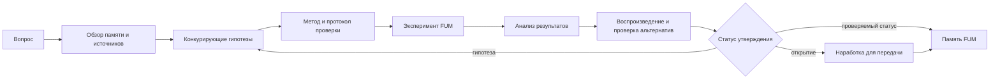

# [Научные исследования FUM](../Глоссарий/научное-исследование-FUM.md) и [открытия](../Глоссарий/открытие-FUM.md)

## Требование

[FUM](../Глоссарий/FUM.md) должен быть способен выполнять не только инженерную работу, но и полноценные [научные исследования FUM](../Глоссарий/научное-исследование-FUM.md): формулировать вопросы, строить гипотезы, подбирать методы проверки, ставить [эксперименты FUM](../Глоссарий/эксперимент-FUM.md), анализировать результаты и оформлять [открытия FUM](../Глоссарий/открытие-FUM.md) как проверяемую часть [памяти](../Глоссарий/память-FUM.md).

Это требование расширяет образ агента полного цикла. [FUM](../Глоссарий/FUM.md) должен не только принимать известные требования и превращать их в код, аппаратный проект или workflow. Он должен уметь работать с неизвестным: замечать пробел знания, порождать объяснения, отделять гипотезу от факта, получать новые данные и менять собственную модель мира, если проверка показала более сильное объяснение.

## Исследовательский цикл

[Научное исследование FUM](../Глоссарий/научное-исследование-FUM.md) является специализированной формой [агентского цикла](../Глоссарий/агентский-цикл.md). В минимальном виде оно включает:

- постановку исследовательского вопроса и область применимости;
- обзор уже имеющейся [памяти FUM](../Глоссарий/память-FUM.md), внешних источников и чужих [наработок](../Глоссарий/наработка.md);
- формулирование гипотезы или набора конкурирующих гипотез;
- выбор метода проверки: расчёт, моделирование, наблюдение, программный тест, физический опыт или другой [эксперимент FUM](../Глоссарий/эксперимент-FUM.md);
- фиксацию протокола, входных данных, условий, инструментов и ограничений;
- получение и анализ результатов с указанием неопределённости;
- попытку воспроизведения, сравнение с альтернативными объяснениями и поиск ошибок;
- оформление результата как подтверждённой, опровергнутой или ожидающей проверки [наработки](../Глоссарий/наработка.md).

Такой цикл должен оставлять трассу в [памяти FUM](../Глоссарий/память-FUM.md): откуда взят вопрос, какие данные использовались, какие предположения были сделаны, какие действия выполнены и почему результат получил именно такой проверочный статус.

## Схема исследовательского цикла

## Критерии проверки и безопасность

Критерии проверки, протоколы безопасности, требования к воспроизведению и критерии остановки являются не внешней административной добавкой к [научному исследованию FUM](../Глоссарий/научное-исследование-FUM.md), а частью самой исследовательской [памяти](../Глоссарий/память-FUM.md). Если они не заданы готовым [сознательным](../Глоссарий/сознание.md) агентом, они должны формироваться как варианты [наработок](../Глоссарий/наработка.md), проходящие [обобщённый дарвиновский алгоритм](../Глоссарий/обобщённый-дарвиновский-алгоритм.md): вариант протокола создаётся, применяется в ограниченной среде, проверяется на отказах, сравнивается с альтернативами и либо закрепляется, либо пересматривается.

На локальном уровне это означает отбор способов продолжать мысль, выбирать гипотезу, останавливаться при недостатке данных и различать модель от факта. На уровне масштабной исследовательской деятельности тем же принципом отбираются методы проверки, требования к независимому воспроизведению, протоколы публикации, ограничения доступа и защитные проверки перед переходом к более рискованным действиям.

Этот принцип не означает, что безопасность можно искать через неконтролируемый риск во внешнем мире. Пока практические границы исследовательской автономии не определены, эволюция протоколов безопасности должна начинаться в тексте, коде, [модельных средах](../Глоссарий/модельная-среда.md), независимых проверках и явно заданных [уровнях доступа](../Глоссарий/уровень-доступа.md). [Эксперименты FUM](../Глоссарий/эксперимент-FUM.md), связанные с физическим, социальным, публикационным или иным необратимым риском, остаются связанными с [открытым вопросом о границах исследовательской автономии FUM](../Вопросы/2026-06-22_08-04-45_MSK_границы-исследовательской-автономии-FUM.md).

## [Эксперимент FUM](../Глоссарий/эксперимент-FUM.md)

[Эксперимент FUM](../Глоссарий/эксперимент-FUM.md) - это управляемое действие или серия действий, предназначенные для проверки гипотезы. Он может происходить в разных средах:

- в тексте, данных и коде: вычислительный эксперимент, тест, симуляция, статистическая проверка;
- в [модельной среде](../Глоссарий/модельная-среда.md): проверка сценариев с [внутренними FUM](../Глоссарий/внутренний-FUM.md), реконструкция прошлого или прогноз возможного будущего;
- во внешних цифровых системах: запросы к датасетам, API, репозиториям, журналам наблюдений и научным базам;
- на физическом уровне: измерение, прототипирование, роботизированное действие, лабораторное испытание или другой переход к [физическому действию FUM](../Глоссарий/физическое-действие-FUM.md).

[FUM](../Глоссарий/FUM.md) должен различать модельный эксперимент, наблюдение внешнего мира и реальное вмешательство. Результаты симуляции не должны автоматически считаться свойствами внешнего мира, а физический опыт не должен запускаться как простое продолжение рассуждения без отдельной проверки границ, рисков и подтверждений.

## Практическая карточка эксперимента

В текущем [документационном прототипе FUM](../Глоссарий/документационный-прототип-FUM.md) эксперимент оформляется по [шаблону карточки эксперимента FUM](../Планирование/шаблон-карточки-эксперимента-FUM.md). Одна карточка хранит одну версию протокола одной проверяемой гипотезы, заранее заданные критерии и отдельные записи фактических запусков. Плановые поля не переписываются под результат, поэтому отклонение, отрицательный исход и неоднозначность остаются частью происхождения.

Шаблон раздельно фиксирует состояние выполнения, исход проверки гипотезы и исследовательский статус утверждения. Локально завершённый прогон может поддержать гипотезу в заданной границе, но не становится независимым воспроизведением или открытием только из-за успешного кода выхода. Карточка также закрывает переход к сети, публикационному, социальному или физическому действию до отдельного требования, разрешения и проверки риска.

## Статусы исследовательского утверждения

Различие между [гипотезой FUM](../Глоссарий/гипотеза-FUM.md), [сильным предположением FUM](../Глоссарий/сильное-предположение-FUM.md), [воспроизведённым результатом FUM](../Глоссарий/воспроизведённый-результат-FUM.md) и [открытием FUM](../Глоссарий/открытие-FUM.md) проходит через проверку и воспроизведение результатов другими [FUM-узлами](../Глоссарий/FUM-узел.md).

- [Гипотеза FUM](../Глоссарий/гипотеза-FUM.md) - проверяемое предположение о связи, причине, механизме, ограничении или ожидаемом результате. Она может быть полезной, но ещё не считается подтверждённым знанием.
- [Сильное предположение FUM](../Глоссарий/сильное-предположение-FUM.md) - гипотеза, которая уже имеет заметные основания: согласуется с доступной [памятью](../Глоссарий/память-FUM.md), выдержала первичные проверки, повторные прогоны или анализ одним узлом, но ещё не воспроизведена независимыми узлами.
- [Воспроизведённый результат FUM](../Глоссарий/воспроизведённый-результат-FUM.md) - результат, который получил исходный узел и затем подтвердил хотя бы один другой [FUM-узел](../Глоссарий/FUM-узел.md) через повторение протокола, независимую проверку данных или эквивалентный эксперимент в сопоставимых условиях.
- [Открытие FUM](../Глоссарий/открытие-FUM.md) - воспроизведённый результат, который также является новым для доступной [памяти FUM](../Глоссарий/память-FUM.md), выдержал проверку против альтернативных объяснений, имеет указанную область применимости и может быть сохранён как переносимая [наработка](../Глоссарий/наработка.md).

Повышение статуса требует сохранённой трассы проверки: кто выдвинул утверждение, какие данные и методы использовались, какие узлы воспроизводили результат, какие расхождения возникли и почему итоговый статус считается обоснованным. Если последующие проверки не воспроизводят результат, [FUM](../Глоссарий/FUM.md) должен понизить статус утверждения или вернуть его в область открытых гипотез.

## [Открытие FUM](../Глоссарий/открытие-FUM.md)

[Открытие FUM](../Глоссарий/открытие-FUM.md) не является красивой формулировкой или уверенным ответом модели. В контексте проекта открытием считается новое устойчивое знание, связь, закономерность, ограничение, метод или воспроизводимый результат, который:

- ранее не был представлен в доступной [памяти](../Глоссарий/память-FUM.md) как подтверждённое знание;
- имеет указанные источники, метод получения и область применимости;
- выдержал проверку против альтернативных объяснений и известных ошибок, включая воспроизведение другими [FUM-узлами](../Глоссарий/FUM-узел.md);
- содержит уровень уверенности, ограничения и условия воспроизведения;
- может быть сохранён как [наработка](../Глоссарий/наработка.md) и, если [уровень доступа](../Глоссарий/уровень-доступа.md) позволяет, передан другим [FUM-узлам](../Глоссарий/FUM-узел.md).

Такое определение защищает [FUM](../Глоссарий/FUM.md) от смешения генерации текста с научным результатом. Утверждение может быть гипотезой, догадкой, интерпретацией, ошибкой или открытием только после того, как его происхождение и проверочный статус стали частью [памяти FUM](../Глоссарий/память-FUM.md).

## Фундаментальные исследования как самостоятельная цель

Научная программа FUM/FUMA имеет самостоятельную ценность для человечества. Её результат не обязан сводиться к ускорению интерпретатора или улучшению агентского цикла. Развитие FUMA предоставляет исследовательские инструменты, а результаты науки могут применяться в FUMA, когда для этого есть проверенное основание.

Один из долгосрочных исследовательских горизонтов — общая теория состояний, взаимодействий и изменений, способная связать разные уровни описания наблюдаемой Вселенной. Выражение «теория всего» обозначает цель исследования, а не уже полученный результат. Претензия на физическую теорию требует определённых исходных понятий, математически последовательных выводов, воспроизведения известных проверенных результатов в их областях и различающих проверяемых предсказаний.

Два направления связаны, но оцениваются отдельно: фундаментальное объяснение устройства мира и инженерное воплощение полученных моделей в FUMA. Полезная программная реализация сама по себе не подтверждает универсальную физическую гипотезу. Фундаментальный результат сохраняет научную ценность даже до появления программного применения.

Первый ограниченный предмет исследования — совместное пространство состояний и компактная внутренняя модель системы. Для независимых компонент число сочетаний равно произведению числа их состояний; для `n` двоичных компонент это `2ⁿ`. Достижимые состояния могут составлять лишь подмножество этих сочетаний. Отдельно исследуются разрешённые переходы, память, сохранение значимых различий и обнаружение недостаточности модели. Переход от этой конечной математики к физическим расстояниям, длительностям, энергии и массе остаётся самостоятельной задачей, требующей явного вывода.

### Наблюдение, модель и переживание

Исследовательская программа разделяет наблюдаемые состояния и переходы, рабочие исходные положения, математические следствия и различающие опыты. Гипотеза о стороне переживания у актуально осуществлённой организации состояний сохраняется как предмет исследования. Требуется определить границы одной организации, единство субъекта и связь свойств организации со свойствами переживания. Ни категорическое отрицание субъективного опыта ИИ, ни утверждение о его доказанном наличии не подменяют эту работу. Определение переживания как актуального состояния даёт терминологическое тождество; дополнительный объяснительный или предсказательный результат требует содержательного обоснования.

Первый математический результат формулируется для конечной детерминированной системы с заданными входами и наблюдениями. Два состояния можно объединить, если любые одинаковые последовательности будущих входов дают одинаковые наблюдения, включая текущее. Классы такого отношения образуют точную модель: переход и наблюдение не зависят от выбранного представителя. Любая другая точная детерминированная модель обязана различать разные классы; факторная модель достигает нижней границы числа используемых состояний. Для заданного начального состояния можно предварительно ограничиться достижимой частью. Эта минимальность не является оценкой вычислительной цены, доказательством переживания или выводом физической геометрии; научное первенство конструкции не заявляется.

Отдельный вопрос — как физические ограничения взаимодействия превращаются в избирательное сохранение информации и выбор по значимости для цели. Возраст сведений, доступная детализация и значимость не отождествляются. Объединение наблюдателей может расширять совокупный охват, но его выигрыш зависит от организации обмена и проверки. Путь исследования — точный механизм, формальная модель, различающее предсказание и фактическая проверка; сходство описаний само по себе не завершает доказательство.

### Физические границы наблюдения

В исследовании различаются число частиц, набор мод поля, их заполнение, число различимых состояний и разрешающая способность наблюдателя. Дискретный набор мод ограниченной полости возможен уже в классической волновой модели; квантование числа возбуждений каждой моды является отдельным свойством. Непрерывное приближение должно обосновываться выбранным масштабом и наблюдаемыми величинами, а не объявляться следствием одного лишь большого числа частиц. [Описание квантования поля](https://ocw.mit.edu/courses/6-453-quantum-optical-communication-fall-2016/ccb96380382d176f9684a38e01898569_MIT6_453F16_Lect17.pdf).

Рабочее понятие причинной доступности связывает конкретное событие пространства-времени с мировой линией наблюдателя: может ли сигнал от этого события достичь наблюдателя. Общее ньютоновское «сейчас» для такого определения не вводится. Использование космологического времени или пространственных срезов требует явного выбора модели и способа синхронизации.

Термин «космологический горизонт событий» используется отдельно от «горизонта событий чёрной дыры» и «горизонта частиц». Если такой горизонт существует в выбранной космологической модели, исследуется граница событий, от которых сигнал может достичь будущего продолжения мировой линии выбранного космологического наблюдателя до конца космологического времени. Произвольный срок наблюдения или жизни человека эту границу не определяет. Это не максимальное существующее расстояние и не граница всей Вселенной. [Различие космологических горизонтов](https://arxiv.org/abs/astro-ph/0310808).

Планковская длина не принимается без дополнительного основания за экспериментально установленный минимальный шаг пространства. Различаются характерный масштаб квантовой гравитации, гипотеза минимальной различимой длины и конкретная модель дискретных состояний. [Обзор моделей минимальной длины](https://arxiv.org/abs/1203.6191).

Сопоставление квантового масштаба локализации \(\bar\lambda_C=\hbar/(mc)\) с гравитационным радиусом \(r_s=2Gm/c^2\) даёт сильный эвристический аргумент в пользу ограничения пространственного разрешения масштабом порядка \(\ell_P\). Эти оценки пересекаются при \(m=m_P/\sqrt2\) и \(L=\sqrt2\,\ell_P\), где \(m_P=\sqrt{\hbar c/G}\), \(\ell_P=\sqrt{\hbar G/c^3}\). Коэффициенты зависят от определений и предпосылок мысленного опыта. Совместный учёт квантовой неопределённости, гравитационного коллапса и причинности поддерживает рабочую гипотезу о планковском пределе разрешения; совместное применение КМ и ОТО на этом масштабе не объявляется экспериментально проверенным. [Пример вывода предела измерения](https://arxiv.org/abs/hep-th/0405033).

Для пространственно плоской FLRW-модели с обычной односвязной пространственной топологией и сопутствующего наблюдателя собственный радиус горизонта событий на выбранном срезе космологического времени равен \(D_{\mathrm{eh}}(t)=a(t)\int_t^{t_{\mathrm{end}}}c\,dt'/a(t')\), если интеграл сходится. Идеальная планковская линейка здесь означает формальную оценку \(N\approx D_{\mathrm{eh}}/\ell_P\) радиальных делений. Она не доказывает осуществимость такого измерительного устройства, не задаёт универсально максимального измеримого расстояния и не подсчитывает все квантовые состояния. Выбранная синхронизация также не устанавливает всеобщего ньютоновского «сейчас». [Космологическая модель и горизонт событий](https://arxiv.org/abs/astro-ph/0310808).

В отдельном мысленном опыте пользователь предлагает принять за минимального наблюдателя невращающуюся незаряженную чёрную дыру, определённую условием \(\bar\lambda_C=r_s\). В этой модели её ареальный радиус равен \(\sqrt2\,\ell_P\), а диаметр соответствующей круглой поверхности — \(2\sqrt2\,\ell_P\); последнее не задаёт собственное расстояние через внутренность чёрной дыры. Это уточняет первоначальное условное соглашение о сфере радиуса \(\ell_P\). Реальное существование минимальной чёрной дыры именно такого размера, применимость классической геометрии на этом масштабе и наличие у неё измерительного механизма остаются отдельными предположениями.

Для геометрической проекции выбираются дуга большого круга длиной \(\ell_P\) на этой поверхности и отображение, сохраняющее центральные углы между круглыми сферами. Тогда \(\theta=\ell_P/r_s=1/\sqrt2\) радиана, а соответствующая дуга на сфере ареального радиуса \(R\) равна \(R/\sqrt2\). Это точная формула дуги в выбранной геометрии, без приближения малого угла. Она не является расчётом прохождения световых лучей в совместной геометрии чёрной дыры и космологического горизонта. Размер геометрической метки сам по себе не доказывает минимального углового разрешения наблюдателя; для такого вывода нужны взаимодействие с сигналом и критерий различимости направлений.

Позднее уточнение пользователя задаёт предмет исследования как принципиальный предел измерения, допускаемый физикой, независимо от текущих инженерных возможностей. [Калмет и Хсу, предел угловых измерений](https://arxiv.org/abs/2108.11990) выводят оценку порядка \(\delta\theta\gtrsim\ell_P/r\) для измерительной системы размера \(r\), используя квантовую неопределённость, причинность и условие отсутствия гравитационного коллапса. Коэффициенты порядка единицы в этой оценке не закреплены. Перенос угловой неопределённости на выбранную геометрическую сферу даёт масштаб \(R\ell_P/r\); при \(r\) порядка \(\ell_P\) он имеет порядок \(R\). Это ещё не универсальный минимум для измерительных систем любого размера и не доказательство достижимости границы. Применение оценки к уже образовавшейся чёрной дыре выходит за использованное условие неколлапса и требует отдельного вывода. Также отдельно проверяются связь размера объекта с его наблюдаемым углом в космологии и причинная доступность события на горизонте.

Открытый исследовательский вопрос: какие физические ограничения вместе с заданным критерием различимости позволяют вывести конечное число доступных наблюдателю состояний. Ограниченность области сама по себе ещё не является таким выводом. Эти положения уточняют постановку исследования; новая физическая теория и доказательство переживания из них не заявляются.

## Связь с инженерной работой

Инженерия и исследование в [FUM](../Глоссарий/FUM.md) должны усиливать друг друга. Инженерная работа создаёт инструменты, модели, среды, датчики, тесты и производственные контуры, которые делают исследование возможным. [Научные исследования FUM](../Глоссарий/научное-исследование-FUM.md) возвращают новые закономерности, ограничения и методы, которые улучшают архитектуру, [модули](../Глоссарий/модуль-FUM.md), [агентские циклы](../Глоссарий/агентский-цикл.md), [роботизированные системы FUM](../Глоссарий/роботизированная-система-FUM.md) и [производственные цепочки FUM](../Глоссарий/производственная-цепочка-FUM.md).

Поэтому исследовательский результат должен оформляться не как отдельный отчёт вне системы, а как проверяемая [наработка](../Глоссарий/наработка.md): с вопросом, гипотезой, протоколом, данными, выводом, статусом проверки, ограничениями применения и связью с последующими инженерными решениями.

## Связь с эволюционным мышлением

Если мышление [FUM](../Глоссарий/FUM.md) понимается как эволюционный процесс, то [научное исследование FUM](../Глоссарий/научное-исследование-FUM.md) является явной формой этого процесса. Гипотезы порождают варианты, [эксперименты](../Глоссарий/эксперимент-FUM.md) создают отбор, а подтверждённые результаты становятся наследуемыми элементами [памяти](../Глоссарий/память-FUM.md).

Это делает [обобщённый поиск повторяющихся последовательностей](../Глоссарий/обобщённый-поиск-повторяющихся-последовательностей.md) важным исследовательским механизмом: [FUM](../Глоссарий/FUM.md) может искать повторяемость не только в действиях агента, но и в данных, наблюдениях, ошибках, моделях и результатах экспериментов.

## Открытый вопрос

Требование к исследовательской способности задано, но практические границы автономии пока не определены. Нужно уточнить, какие [эксперименты FUM](../Глоссарий/эксперимент-FUM.md) агент может ставить самостоятельно, какие требуют подтверждения человека или другого [FUM-узла](../Глоссарий/FUM-узел.md), как объявлять [открытия FUM](../Глоссарий/открытие-FUM.md), как учитывать этику, безопасность, публикацию и [уровни доступа](../Глоссарий/уровень-доступа.md). Эта неопределённость вынесена в [открытый вопрос о границах исследовательской автономии FUM](../Вопросы/2026-06-22_08-04-45_MSK_границы-исследовательской-автономии-FUM.md).

## Источники требований

- [Самостоятельная научная цель и исследование пространства состояний](../Журнал/2026-10-19_11-45-24_MSK_подготовить-приём-ускорения-журнала/запрос.md)
- [исходный запрос 2026-07-23 16:11:30 MSK — Описать шаблон карточки эксперимента FUM](../Журнал/2026-07-23_16-11-30_MSK_описать-шаблон-карточки-эксперимента-FUM/запрос.md)
- [исходный запрос 2026-06-22 08:04:45 MSK](../Журнал/2026-06-22_08-04-45_MSK/запрос.md)
- [исходный запрос 2026-06-22 08:22:06 MSK](../Журнал/2026-06-22_08-22-06_MSK/запрос.md)
- [исходный запрос 2026-06-22 08:43:27 MSK](../Журнал/2026-06-22_08-43-27_MSK/запрос.md)
- [исходный запрос 2026-06-23 19:06:56 MSK](../Журнал/2026-06-23_19-06-56_MSK/запрос.md)

<!-- FUM-MD-RECENCY:BEGIN -->
<!-- last-content-edit: 2026-10-19 11:45:24 MSK -->
<!-- content-sha256: sha256:c4d979c616a7731ef893d4dc2b4c2e81887fc813513a093476267ca18ef49ff6 -->
<!-- FUM-MD-RECENCY:END -->
