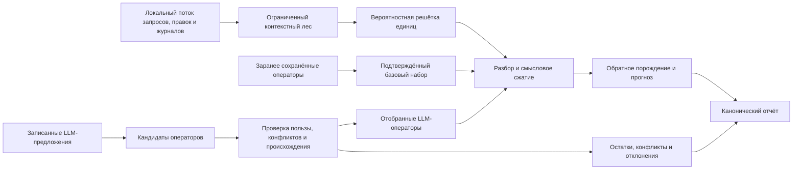

# Память структурирующих операторов

Этот Swift-прототип проверяет минимальную [память FUM](../../Глоссарий/память-FUM.md), в которой [структурирующие операторы FUM](../../Глоссарий/структурирующий-оператор-FUM.md) одновременно распознают малый локальный поток запросов, правок и журналов, дают компактное описание найденной структуры и участвуют в обратном порождении. Ограниченный контекстный лес сохраняет контексты в пределах заданного бюджета и детерминированно отсекает новые после его исчерпания, вероятностная решётка удерживает конкурирующие единицы разбора, а [система структурирующих операторов FUM](../../Глоссарий/система-структурирующих-операторов-FUM.md) связывает форму, смысл, объяснение и проверяемое действие.

Прототип сопоставляет режим заранее сохранённых операторов с режимом LLM-пополнения. Режим пробника использует детерминированный адаптер записанной фикстуры: он воспроизводит заранее сохранённые предложения модели, не вызывает внешнюю LLM, не обращается к сети и не выдаёт записанный ответ за живое модельное исполнение. Предложения адаптера проходят проверку выигрыша, конфликтов, обратимости и происхождения; заранее сохранённые операторы образуют объявленный фикстурой подтверждённый базовый набор, а отчёт различает происхождение обоих источников.

## Проверяемый контур



[Суффиксно-предиктивная память FUM](../../Глоссарий/суффиксно-предиктивная-память-FUM.md) представлена конечным лесом контекстов переменной длины. Бюджет фикстуры ограничивает глубину и число узлов; после исчерпания бюджета новые контексты детерминированно отсекаются, а лес не растёт неограниченно. Отчёт различает установленный лимит, фактическое использование и отсечённые элементы.

[Самотокенизация FUM](../../Глоссарий/самотокенизация-FUM.md) представлена вероятностной решёткой, где один фрагмент может иметь несколько конкурирующих разборов. Низкоуровневые операторы формы описывают окончания, суффиксы и варианты записи, а более высокие операторы связывают языковые реализации через общий семантический узел. Межъязыковой переход не стирает языково-специфичный остаток и не выдаёт частичное соответствие за полную эквивалентность.

## Операторы, кандидаты и отбор

Память хранит версию оператора, уровень, условия распознавания, правила порождения, положительные и отрицательные примеры, связи с нижними и верхними уровнями, цену хранения, доверие и происхождение. Стратифицированные связи образуют проверяемый граф формы, морфосинтаксиса, семантики, дискурса и исполняемой проекции, а не плоский список правил.

Отчёт разделяет несколько уровней наблюдения:

- сценарные метрики содержат общий выигрыш предсказания, выигрыш сжатия с настроенной стоимостью ссылки, качество обратного порождения, признаки точного и операторного восстановления, объёмы сырого и операторно порождённого входа;
- отчёт каждого операторного кандидата содержит поддержку, собственные выигрыши предсказания и сжатия, качество обратного порождения, источник, конфликты, историю переходов и итоговый статус `hypothesis`, `low_confidence`, `confirmed`, `conflicting`, `rejected` или `obsolete`;
- решётка каждого входного элемента содержит конкурирующие единицы, их нормированные вероятности, сырой вес, способ реконструкции и выбранный путь, но не повторяет сценарные gain-метрики;
- остатки, конфликты и события pruning публикуются отдельными коллекциями; удалённый кандидат получает `obsolete`, а его идентификатор и история отбора остаются в отчёте;
- семантическая связь объяснения может отдельно иметь статус `pending_external_review`.

Ошибочный или неполный вход сначала становится диагностическим остатком. Неспособность текущей памяти разобрать фрагмент сама по себе не создаёт новый полезный оператор: кандидат должен повторно применяться, давать положительный выигрыш и не ухудшать требуемую обратимость. Метрики представлены целочисленными `predictionGainMilliBits`, `compressionGainBits` и `roundTripQualityPPM`; вероятности решётки нормируются в целых миллионных долях. Равные Viterbi-оценки разрешаются числом единиц и устойчивым порядком идентификаторов, поэтому повторный запуск одной фикстуры даёт тот же снимок.

## Режимы источника операторов

В режиме заранее сохранённых операторов разбор использует только версионный набор из фикстуры. В режиме LLM-пополнения тот же набор дополняется предложениями через контракт адаптера. Записанный адаптер читает канонический конверт с идентификатором модели, текстом и хэшем запроса, хэшем канонического массива типизированных предложений и самими предложениями; загрузчик пересчитывает оба хэша и проверяет профили и пространства имён до индексирования. Отчёт явно указывает источник записанной фикстуры и отсутствие внешнего модельного исполнения.

Такой режим проверяет границу интеграции, статусы и отбор LLM-предложений, но не качество неизвестной модели и не доступность внешнего runtime. В сценарии синхронизации один [FUM-узел](../../Глоссарий/FUM-узел.md) помечен как LLM-поддерживаемый агент именно через этот записанный адаптер.

## Адаптеры поставщиков LLM

Отдельный исполняемый срез добавляет текстовые запросы и SSE для трёх поставщиков. Он связан с [этапом реализации](../../Журнал/2026-10-25_11-53-25_MSK_реализовать-адаптеры-поставщиков-llm/запрос.md); пробник сценариев продолжает читать записанные фикстуры. Собственных SDK-зависимостей нет. Инструменты модели, мультимодальность и WebSocket в этот срез не входят.

| Поставщик | Закреплённый профиль | Авторизация транспорта |
| --- | --- | --- |
| OpenAI | `POST /v1/responses`, текст, обычный JSON и SSE, `store: false` | Bearer |
| Anthropic | `POST /v1/messages`, `anthropic-version: 2026-10-21`, текст, JSON и SSE | Поддерживаемый `x-api-key` |
| xAI | Собственный `POST /v1/responses`, ограниченный текстовый профиль, `store: false` | Bearer |

Контракты сверены с первичными материалами: [OpenAI Responses](https://developers.openai.com/api/reference/resources/responses/methods/create), [события OpenAI](https://developers.openai.com/api/reference/resources/responses/streaming-events), [Anthropic Messages](https://platform.claude.com/docs/en/api/messages/create), [версии Anthropic](https://platform.claude.com/docs/en/api/versioning), [авторизация Anthropic](https://platform.claude.com/docs/en/manage-claude/authentication), [xAI Responses](https://docs.x.ai/developers/rest-api-reference/inference/responses). Необязательные поля потока xAI проверены по [официальному TypeScript SDK, закреплённая ревизия](https://github.com/xai-org/xai-sdk-ts/blob/025b8412949941257edc234e11295547dadca853/src/types.ts#L538). Общность отдельных полей OpenAI и xAI не означает полной взаимозаменяемости API.

`AutomationExecutor.намерениеВызоваLLM` и кодеки являются чистыми преобразованиями значений. Намерение связывает запрос, точные байты HTTP body, несекретные заголовки и SHA-256. Пример формирования не выполняет HTTP:

```swift
let намерение = try AutomationExecutor.намерениеВызоваLLM(
  ЗапросLLM(
    идентификатор: "запрос-1", поставщик: .опенай,
    запрошеннаяМодель: "идентификатор-доступной-модели",
    сообщения: [.init(текст: "Ответь одним предложением")],
    поток: true, секрет: .init("секрет-поставщика")))
```

Эффект принадлежит `ИсполнительLLM`: он принимает actor `ТранспортLLM`. Для разрешённой отправки используется `ТранспортURLSessionLLM(секреты: источник)`, где `источник` — отдельный actor `ИсточникСекретовLLM`. Значение секрета извлекается непосредственно перед запросом и не входит в Codable-намерение. URLSession использует ephemeral-конфигурацию без cookie, cache и credential storage; перенаправления запрещены, конечные HTTPS-адреса ограничены тремя закреплёнными endpoint. Сетевые и платные вызовы в автономных проверках отсутствуют; доступность модели и реальная авторизация поставщика ими не установлены.

`исполнить(намерение)` сохраняет `ЗаписьВызоваLLM`. Повтор того же идентификатора с тем же намерением возвращает сохранённую запись; другое намерение под тем же идентификатором отклоняется. Одновременно допускаются два активных вызова, всего — 32 записи вместе с активными вызовами. Кэш конечен и не вытесняет старую запись ради повторной отправки. Новый экземпляр исполнителя принимает сохранённую Codable-запись через `восстановить`, проверяет намерение, RAW-хэш и воспроизведённый результат и затем также возвращает её без отправки.

Запись различает запрошенную и наблюдаемую модель, HTTP-статус и безопасные заголовки, точные полученные байты body и их SHA-256, SSE-события, нативные payload, учёт, разобранный текст и типизированный отказ. RAW здесь означает HTTP body, а не TLS-пакеты, сжатое представление или порядок заголовков на проводе. В потоковом разборе UTF-8, BOM, CR/LF/CRLF и многострочное `data` обрабатываются по [WHATWG SSE](https://html.spec.whatwg.org/multipage/server-sent-events.html#parsing-an-event-stream); оборванный хвост не превращается в событие. Неизвестные поля, блоки и нативные числовые лексемы остаются в RAW. Неизвестный счётчик равен `nil`; накопительный Anthropic `output_tokens` заменяет прежнее наблюдение. Учёт неизвестного события сохраняется нативным снимком, без изменения признанных счётчиков. `[DONE]` без нативного терминала не означает успешного ответа.

HTTP-отказ, ошибка внутри HTTP 200, незавершённый терминал, нарушение протокола, отмена и транспортный обрыв различимы. После начала отправки обрыв или отмена оставляют удалённый исход неизвестным. Автоматического retry и переподключения нет. Транспортный отказ хранится отдельно от ошибки локального разбора. По умолчанию body ограничен 8 МиБ, допустимый предел — до 16 МиБ; SSE-рамка ограничена 1 МиБ и общим пределом ответа. Превышение сохраняет полученный допустимый префикс и явный отказ. Конечная `ОтклонениеПриёмаLLM` отдельно хранит первую отклонённую операцию приёма: границу и размеры усечения, повторные заголовки либо число байтов до заголовков. Отброшенные байты не объявляются сохранённым RAW; запись этого наблюдения позволяет воспроизвести локальный отказ. Она фиксирует наблюдение процесса и не является независимым доказательством сетевого происхождения.

При `форматОтвета: .предложения` текст результата должен содержать JSON-массив `OperatorProfile`. Существующий закрытый адаптер проверяет конверт и происхождение `.llm` до выдачи предложений. Прежний `RecordedLLMEnvelope.responseHash` остаётся хэшем канонического массива предложений; новый `хэшСырогоОтвета` относится к точным байтам body. Предложения не исполняются автоматически.

Автономные проверки запускаются из физического корня FUM с приватной сборкой вне checkout:

```sh
FUM_LLM_BUILD_ROOT="$(mktemp -d /private/tmp/fum-llm-check.XXXXXX)"
swift test --package-path Прототипы/память-структурирующих-операторов \
  --scratch-path "$FUM_LLM_BUILD_ROOT" --jobs 2 \
  -Xswiftc -strict-concurrency=complete -Xswiftc -warnings-as-errors \
  --filter 'Проверки.*LLM'
```

Проверки подменяют транспорт и источник секретов, дробят SSE на байтовых границах и сверяют сохранение RAW, ошибок, учёта и воспроизведения. Сборочный каталог остаётся приватным; тестовые ответы открыты и не содержат настоящих ключей.

Малый профиль запускается явно тем же toolchain и условиями сборки:

```sh
env ФУМ_ПРОФИЛЬ_LLM=1 swift test \
  --package-path Прототипы/память-структурирующих-операторов \
  --scratch-path "$FUM_LLM_BUILD_ROOT" --jobs 2 \
  -Xswiftc -strict-concurrency=complete -Xswiftc -warnings-as-errors \
  --filter ПрофильLLM
```

Профиль печатает JSON с монотонными наносекундами: 300 UTF-8 SSE-кадров при фрагментах 1, 32 и 4096 байт, по три повтора; затем три серии сохранения, восстановления и 1000 обращений к кэшу с одной исходной отправкой. Подготовка, хэширование и печать исключены из внутренних замеров. Это локальные Debug-измерения синтетического входа, без вывода о задержке сети или реального поставщика.


## Проверяемые фикстуры

| Идентификатор фикстуры     | Проверяемый результат                                                                                                                                                                    |
| -------------------------- | ---------------------------------------------------------------------------------------------------------------------------------------------------------------------------------------- |
| `local_stream`             | Запросы, правки, журналы и запись сессии строят ограниченный контекстный лес, альтернативы вероятностной решётки и наблюдаемое pruning.                                                  |
| `bad_input_rejection`      | Опечатка в TeX сохраняется как диагностический остаток; записанный LLM-кандидат ошибочной формы отклоняется и не становится оператором.                                                  |
| `exact_roundtrip`          | Markdown, TeX и Swift-код проходят разбор через заранее сохранённые синтаксические операторы и побайтово восстанавливаются с тем же SHA-256.                                             |
| `semantic_compression`     | Операторы заземляют смысловые факты в байтовых диапазонах планового текста; более короткое описание сохраняет обязательные слоты и происхождение, но не объявляется исходной строкой.    |
| `language_forms`           | Русские окончания, согласование и транслитерация обрабатываются языково-специфичными операторами без переноса поверхностного правила на другой язык.                                     |
| `cross_language_graph`     | Русская и английская конструкции связаны через общий событийный фрейм и страты `form → syntax → semantic`; вид, артикль и неоднозначность местоимений остаются явными остатками.         |
| `explainability_and_links` | Человеческое и ориентированное на LLM представления объяснения, символический оператор, примеры и положительные, отрицательные либо неоднозначные связи соединяются проверяемой трассой. |
| `automation_projection`    | Ограниченный фрагмент [языка автоматизаций FUM](../../Глоссарий/язык-автоматизаций-FUM.md) выводится из операторного графа и исполняется чистым закрытым интерпретатором.                |
| `sync_external_confirmed`  | Человекоподобный и LLM-поддерживаемый узлы с разной локальной памятью проходят полный цикл синхронизации и разрешённое совместное действие.                                              |
| `sync_external_divergence` | Несовместимый пересказ сохраняется как расхождение; ложного подтверждения и совместного действия нет.                                                                                    |
| `sync_internal_subnodes`   | Тот же редьюсер, протокол и типы трассы повторяют полный контур между внутренними подузлами `planner` и `executor`.                                                                      |

Фикстуры совместно покрывают малый поток запросов, правок и журналов. Сохранённые ожидания сценариев и канонический отчёт движка делают наблюдаемыми исходные элементы, применённые версии операторов, предложения адаптера, кандидатов и их статусы, выбранные разборы, остатки, конфликты, pruning, метрики, типы актов синхронизации, ролевые привязки, снимки фактов с их историей и итоговое действие.

## Синхронизация знаний

[Естественно-языковая синхронизация знаний FUM](../../Глоссарий/естественно-языковая-синхронизация-знаний-FUM.md) не копирует операторную память между узлами. Синхронизационный снимок сохраняет для каждого узла его тип, текущие факты и отдельную историю фактов; общая трасса хранит последовательность типов речевых актов, ролевые привязки, расхождения и итог совместного действия. Редьюсер проверяет участников каждого акта по фикстуре. Референты `я`, `ты`, `мы`, `вы` и `они` получают явные ролевые привязки, отделённые от идентичности узла, состава группы, доставки, доступа и полномочий.

Сценарий внешних узлов включает утверждение, вопрос, уточнение, исправление, пересказ и подтверждение. Если подтверждение невозможно, расхождение остаётся явным и не маскируется ложным согласием. Совместное действие появляется только после достаточного для него согласования. Отдельный сценарий передаёт тот же поток между внутренними подузлами и проверяет тот же движок, схему отчёта и правила сохранения расхождения.

## Происхождение и воспроизводимость

Канонический отчёт связывает каждый вывод с идентификаторами входных элементов, операторами и их версиями, режимом источника, записанным предложением LLM-адаптера, результатами метрик, конфликтами и решением отбора. Хэш набора фиксирует канонический логический снимок декодированных фикстур, а хэши входных элементов — их точные байты; ни один из них не доказывает истинность содержащихся утверждений.

Пробник не записывает пользовательские файлы, не обращается к сети, не запускает внешний код и не собирает hostname, пользовательские каталоги или другие машинно-локальные идентификаторы. Вывод является детерминированным JSON-отчётом, пригодным для точного сравнения в автономных тестах.

## Отдельное конечное исполнение

[Контракт конечного исполнения](конечное-исполнение.md) описывает отдельный типизированный вход, закрытые определения, общий исполнитель, строгий UTF-8 → Unicode-скаляры → UTF-32LE/BE, пределы, наблюдения и воспроизводимый профиль. Прежние фикстуры вызывают тот же исполнитель через проверочный адаптер.

[Композиция сохранённых определений](композиция.md) добавляет самодостаточный документ v2, явные нерекурсивные применения по идентификатору и версии, общий бюджет и ограниченную вложенную трассу. Старый контракт v1 проверяется по сохранённому полному наблюдению; новые программы повторяются из памяти после удаления исходных файлов.

## Скалярный текст

Шаг `{"оператор":"скаляры-в-текст","аргументы":{"версия":1}}` принимает только Unicode-скаляры и выдаёт текст. Он сохраняет их порядок и точные байты UTF-8: пустой массив даёт пустую строку, NUL остаётся внутри строки, комбинируемые знаки не нормализуются, BOM сохраняется только при наличии исходного скаляра. Версия обязательна; неизвестная версия, лишний аргумент, неверный тип и недопустимый скаляр отклоняются.

Бюджет входа учитывает четыре байта на скаляр в существующем представлении UTF-32BE. Бюджет результата учитывает фактическую длину UTF-8 до добавления очередного скаляра. Расход равен одной операции за шаг плюс одной за скаляр. Хэши шага связывают исходное скалярное представление и выходные UTF-8-байты.

Действующие UTF-8-правила, этот шаг и прежний JSON-граф составляют тестовую байтовую программу без отдельного декодера. Штатный файл JSONL-программы остаётся текстовым; байтовая композиция строится внутри адресных тестов. Провод определения сохраняется штатными `данные()` и `разобрать()`; Codable-поля долговременного исполнения сохраняют исходные и канонические байты определения. Адресные проверки:

```sh
swift test --package-path Прототипы/память-структурирующих-операторов \
  --scratch-path "$FUM_BUILD_ROOT/скаляры" --filter ПроверкиСкалярногоТекста
```

Парный профиль и решение об оптимизации сохранены в [отчёте этапа](../../Журнал/2026-10-04_19-33-17_MSK_соединить-скаляры-и-текст/отчёт.md). Подготовка, сборка и сравнение результатов исключены из внутренних замеров исполнителя и трассы. Сохранённая публичная `связь-сборок.json` — свидетельство; операционный `--связь-сборок` получает приватную карту двух сборок с дополнительным полем `исполняемый` на каждой стороне. Поле должно указывать точный `SCRATCH/out/Products/Release/FUMStructuringOperatorMemoryTests.xctest/Contents/MacOS/FUMStructuringOperatorMemoryTests`; его SHA сверяется с картой до и после серии. Воспроизведение создаёт свои release-сборки и свежую карту с их SHA и исходниками, а не выдаёт новые бинарники за прежние. `--проверить-связь` запускает синтетическую проверку отказа неверной карты без внешнего Swift. Прежняя серия сохранена внутри `предыдущая_серия` как полный разобранный JSON с SHA её первоначальных байтов; исходное форматирование остаётся в приватном файле.

### Профиль текущего исполнителя

Для одной новой серии текущего принятого алгоритма нужен новый пустой приватный каталог сборки и отсутствующий файл результата. Release-сборка тестов явно включает поддержку `@testable`; тот же режим передаётся при запуске. Команды выполняются из физического корня FUM:

```sh
swift build --build-system native --package-path Прототипы/память-структурирующих-операторов \
  --scratch-path "$FUM_BUILD_ROOT/скалярный-Release" -c release --jobs 2 \
  --build-tests -Xswiftc -enable-testing
env "ФУМ_ВЫХОД_ПРОФИЛЯ_СКАЛЯРОВ=$FUM_BUILD_ROOT/профиль-скалярного-текста.json" \
  swift test --build-system native --package-path Прототипы/память-структурирующих-операторов \
  --scratch-path "$FUM_BUILD_ROOT/скалярный-Release" -c release -Xswiftc -enable-testing \
  --skip-build --filter '^FUMStructuringOperatorMemoryTests[.]ПроверкиСкалярногоТекста/test_ПрофильСкалярногоТекста$'
```

Ожидается один фактически исполненный XCTest без пропуска и JSON `fum.профиль-скалярного-текста.1` с семью рядами. Перед запуском и после него сверяются текущие исходники, ресурсы и SHA фактического тестового бинарника свежей сборки. Имя продукта получают из текущего `--show-bin-path`, не из исторической карты. Новый [профиль ROOT](../../Журнал/2026-10-04_23-15-07_MSK_принять-скалярный-текст-интерпретатора/материалы/профиль-текущего-исполнителя-ROOT.json) и [его связь с исходниками](../../Журнал/2026-10-04_23-15-07_MSK_принять-скалярный-текст-интерпретатора/материалы/связь-текущего-профиля-ROOT.json) содержат одну серию принятого варианта. Она не является новой парой A/B и не доказывает ускорение. Начало входа — Unicode-скаляры; UTF-8-декодирование, JSONL, интерфейс и память процесса этим замером не охвачены.

## Как запустить

Без аргументов точка входа выполняет весь безопасный набор детерминированных фикстур:

```bash
./Прототипы/память-структурирующих-операторов/запустить.sh
```

Явный повтор и справка:

```bash
./Прототипы/память-структурирующих-операторов/запустить.sh --list
./Прототипы/память-структурирующих-операторов/запустить.sh fixture exact_roundtrip
./Прототипы/память-структурирующих-операторов/запустить.sh --help
```

## Проверки

```bash
swift test \
  --package-path Прототипы/память-структурирующих-операторов
swift build \
  --package-path Прототипы/память-структурирующих-операторов \
  --product FUMStructuringOperatorMemoryProbe
swift format lint \
  --configuration Инструменты/fum-kompleksnaya-proverka-repozitoriya/swift-format.json \
  --strict \
  --recursive \
  Прототипы/память-структурирующих-операторов/Package.swift \
  Прототипы/память-структурирующих-операторов/Sources \
  Прототипы/память-структурирующих-операторов/Tests
```

Автономные тесты подтверждают детерминизм канонического отчёта, лимиты леса, решётки и кандидатов, режимы источника, gain-метрики, качество обратного порождения, статусы и pruning, диагностические остатки, конфликты, языковые уровни, стратифицированные связи, символическую объяснимость, исполняемую проекцию и три сценария синхронизации. Отрицательные проверки отклоняют повреждённый конверт, невалидные хэши и профили, коллизии идентификаторов, висячие графовые и смысловые связи, неподтверждённую автоматизацию, нерелевантное подтверждение и ложноположительный смысловой факт; вероятная ошибка входа не становится оператором.

## Структура

- `Sources/FUMStructuringOperatorMemory/` — неизменяемые контракты, ограниченный контекстный лес, вероятностная решётка, операторная память, разбор, порождение, метрики, отбор, синхронизация и отчёты;
- `Sources/FUMStructuringOperatorMemory/Фикстуры/` — входные сценарии с проверяемыми ожиданиями и повреждённый отрицательный LLM-конверт, упакованные SwiftPM как ресурсы library target;
- `Sources/FUMStructuringOperatorMemoryProbe/` — безопасный запуск полного набора фикстур и справка;
- `Tests/FUMStructuringOperatorMemoryTests/` — автономная приёмка без сети, секретов и внешних зависимостей;
- `Package.swift` — самостоятельный SwiftPM-пакет без внешних зависимостей;
- `запустить.sh` — POSIX-точка входа, независимая от текущего каталога.

## Граница применимости

Прототип подтверждает только механику небольшого конечного набора вручную подготовленных потоков и операторов. Его pruning со статусом `obsolete` и сохранением истории кандидата не реализует [управляемое забывание FUM](../../Глоссарий/управляемое-забывание-FUM.md): у прототипа нет поконтурного веса и порога прекращения работы, мета-уровня обнаружения, разделения хранения и работоспособности, [вспоминания FUM](../../Глоссарий/вспоминание-FUM.md), безвозвратного забывания или отбора их темпа. Он также не доказывает качество самотокенизации на произвольных данных, статистическую калибровку вероятностей, универсальность коэффициентов пользы, полноту русского или английского языка, корректность произвольного перевода, безопасность синтезированной программы, долговременную консолидацию памяти или эффективность на большом потоке.

Записанный LLM-адаптер не исполняет модель, не измеряет её вариативность и не подтверждает качество живых предложений. Сценарии синхронизации работают последовательно в одном процессе и не доказывают распределённую согласованность, конкурентность, разграничение доступа или устойчивость к недоверенному узлу. Внутренние подузлы представлены тем же локальным протоколом, но прототип не утверждает их отдельное сознание, самостоятельный runtime или готовый [агентский цикл](../../Глоссарий/агентский-цикл.md).

Связь с языком автоматизаций включает прежнюю исполняемую проекцию и конечные определения над закрытым набором общих операторов. Она не является готовой грамматикой языка, компилятором или разрешением на внешние эффекты. Все численные метрики и пороги принадлежат проверочной фикстуре и не считаются универсальными параметрами FUM.

Статус: ограниченный проверочный Swift-прототип с автономными фикстурами и честной границей записанного LLM-адаптера.

## Источники требований

- [Реализация конечного исполнения и UTF-32](../../Журнал/2026-09-11_07-43-37_MSK_реализовать-интерпретатор-и-UTF-32/запрос.md).

- [исходный запрос 2026-07-31 12:20:47 MSK - Уточнить вспоминание и безвозвратное забывание](../../Журнал/2026-07-31_12-20-47_MSK_уточнить-вспоминание-и-безвозвратное-забывание/запрос.md)
- [исходный запрос 2026-07-31 11:57:37 MSK - Закрепить управляемое забывание FUM](../../Журнал/2026-07-31_11-57-37_MSK_закрепить-управляемое-забывание-FUM/запрос.md)

- [исходный запрос текущей рабочей сессии](../../Журнал/2026-07-24_03-39-33_MSK_подготовить-Swift-прототип-памяти-структурирующих-операторов-FUM/запрос.md)

## Опорные материалы

- [Потоковая самоструктуризация FUM](../../Документация/32-потоковая-самоструктуризация-FUM.md)
- [Система структурирующих операторов FUM](../../Документация/33-система-структурирующих-операторов-FUM.md)
- [Естественный язык и синхронизация знаний FUM](../../Документация/34-естественный-язык-и-синхронизация-знаний-FUM.md)
- [LLM-ориентированный язык автоматизаций](../../Документация/21-LLM-ориентированный-язык-автоматизаций.md)
- [Модель памяти FUM](../../Документация/01-модель-памяти-FUM.md)
- [Архитектура FUM](../../Документация/22-архитектура-FUM.md)
- [открытый вопрос о границах естественно-языковой синхронизации знаний FUM](../../Вопросы/2026-07-13_20-34-23_MSK_границы-естественно-языковой-синхронизации-знаний-FUM.md)

## Генерация нативных моделей

Конечный исполнитель дополнен шагами `разобрать-структурный-контракт` и `породить-представление`. Они исполняются через тот же `AutomationExecutor.выполнить`, сохраняют следы, стоимость и SHA входа. [Рабочий контракт и команды](../../Проекты/рабочий-контекст/операторные-модели-ответа.md) показывают генерацию Swift Codable и Python из одного описания. [Происхождение минимального переноса и приёмка](../../Журнал/2026-09-14_15-54-44_MSK_породить-модели-ответа-операторами/отчёт.md) отделяют исторические свидетельства от 45 тестов того этапа. Это сохранённое число не описывает весь текущий состав цели.

<!-- FUM-MD-RECENCY:BEGIN -->
<!-- last-content-edit: 2026-10-25 13:04:04 MSK -->
<!-- content-sha256: sha256:4dc13aca8196913e88cc4edd6839448d17dcd8dffb5d7b5a62866f09399f8e3b -->
<!-- FUM-MD-RECENCY:END -->
