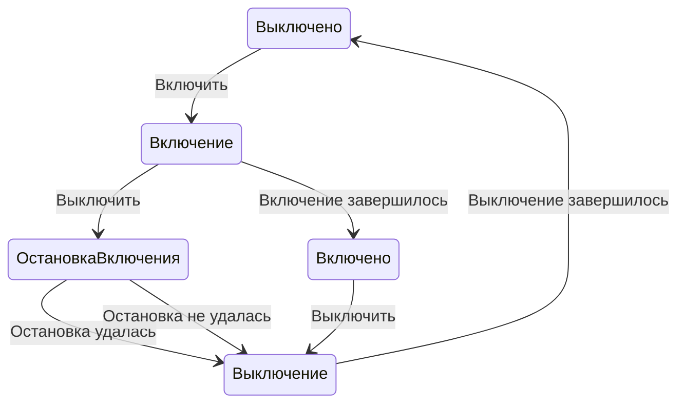

# Пользовательское перенаправление непрерывного агентского цикла

<!-- FUM-REQUIREMENT-ID: FUM-REQ-0017 -->

[Коробочная реализация FUM](../Глоссарий/коробочная-реализация-FUM.md) должна поддерживать логически продолжающийся [агентский цикл](../Глоссарий/агентский-цикл.md), в котором новый разрешённый пользовательский вход может изменить дальнейшую работу, не дожидаясь потери уже сохранённого состояния. На ближайшей безопасной контрольной точке цикл должен связать вход с прежним состоянием и заново выбрать наблюдаемое продолжение: сохранить или уточнить цель, изменить приоритет либо план, перейти в другую ветку, приостановить или завершить работу либо запросить уточнение.

Изменение «траектории мышления» проверяется через наблюдаемые цель, приоритет, план, ветку, выбранное действие, проверку и следующее продолжение, а не через доступ к скрытым рассуждениям модели. Непрерывность управляющего контура не означает непрерывный inference: отдельные модельные шаги, задачи и действия могут быть дискретными, пока память, происхождение и правило возобновления связывают их в один проверяемый ход работы.

## Раздельные команды и целевое состояние

В интерфейсе FUM включение и выключение, запуск и остановка представлены отдельными элементами с постоянным назначением. Кнопка «Отправить» не заменяется кнопкой «Стоп» в той же области после отправки. Изменение состояния может менять доступность действия и отображение результата, но не подменяет его противоположным действием под неподвижным курсором или фокусом ввода.

Кнопка и словесная команда имеют общий смысл: привести конкретный объект к явно заданному целевому состоянию. Команда задаёт состояние, а не инвертирует текущее. Если нужное состояние уже достигнуто либо переход к нему уже выполняется, повтор той же команды сохраняет состояние или тот же переход и не создаёт нового выполнения. Объект, аргументы и применимая версия состояния входят в идентичность команды; другая цель не смешивается с повтором.

Интерфейс различает запрос перехода, выполняющийся переход и подтверждённое состояние. Сам факт нажатия не считается достигнутым результатом; неизвестный исход не превращается в разрешение повтора. Принятая команда и связанный переход сохраняются так, чтобы серия кликов или повтор словесного запроса не создавала второй эффект.

Проверяемые сценарии: повторный клик после отправки при неподвижном курсоре не останавливает работу; серия команд включения из выключенного состояния создаёт один переход; повтор включения во включённом состоянии не выполняет переход; серия выключений симметрична; словесный и кнопочный входы на одном объекте и одной цели дают тот же результат. Ошибка, задержка и неизвестное подтверждение отображаются отдельно от достигнутого состояния. Эти сценарии приняты как требования, но ещё не исполнены в собственном интерфейсе.

Основание — [прямые команды и два предоставленных пользователем снимка](../Журнал/2026-11-04_10-57-20_MSK_проверить-снимок-цикла-Codex-программой-FUMA/запрос.md). На снимках внешнего приложения наблюдается замена символа отправки символом остановки в одной позиции. Сохранение курсора в этой области — сообщение пользователя; факт случайной остановки снимками не доказан. Исходные изображения остаются частными, публично сохраняется описание наблюдения. Изменение интерфейса внешнего приложения этим требованием не заявляется.

### Выключение во время включения

Если команда выключения поступает во время процесса включения, она сначала запускает остановку включения. После завершения попытки остановить включение запускается отдельный процесс выключения независимо от успеха или неуспеха этой попытки. Даже успешная остановка включения сама по себе не считается окончательным подтверждением выключенного состояния. Возврат к прежней цели «включено» в этой ветви не выполняется. Повтор выключения во время остановки включения или выключения не создаёт второй процесс. Конечная цель подтверждается результатом самого выключения; неизвестный исход остановки не выдаётся за завершённую попытку.

Отмена является отдельной явной командой, связанной с конкретным переходом и его исходным состоянием. Принятие отмены, остановка процесса, неудача остановки и достижение выключенного состояния наблюдаются отдельно. Незавершённая либо неудачная остановка не объявляется успешным выключением. Проверка этого протокола в конечной FUMA-программе и фактическая остановка нативного процесса имеют разные свидетельства.

## Семантические связи

- **дополняется:** [наблюдаемым состоянием агентского runtime и интерфейса](🟡-наблюдаемое-состояние-агентского-runtime-и-интерфейса.md) — связывает корректировку работы с подтверждёнными состояниями задачи и её интерфейса.
- **усиливается:** [автономным модельным продолжением при ожидании подтверждения](🟡-автономное-модельное-продолжение-при-ожидании-подтверждения.md) — ожидание сигнала блокирует только подтверждаемый переход, пока безопасная продуктивная модельная работа остаётся возможной.
- **усиливается:** [непрерывным событийным наблюдением пользовательского ввода](🟡-непрерывное-событийное-наблюдение-пользовательского-ввода.md) — коробочная форма переносит перенаправление с границ сообщений-задач на разрешённые события, поступающие во время работы.
- **дополняет:** [выбор следующего шага ветки из карточек шагов](✅-выбор-следующего-шага-ветки-из-карточек-шагов.md) — обобщает уже проверенную смену продолжения между дискретными задачами до контракта работающего продуктового цикла.

## Критерии проверки

- детерминированный сценарий запускает цикл с незавершённым планом, вводит новый разрешённый пользовательский сигнал до терминального состояния и подтверждает его приём во время работы;
- на ближайшей объявленной безопасной контрольной точке цикл либо сохраняет прежний план с объяснимым основанием, либо изменяет цель, приоритет, план, ветку или действие;
- трасса связывает прежнее состояние, пользовательский вход, решение о перенаправлении, отменённые либо отложенные действия и новое продолжение, не раскрывая скрытые рассуждения модели;
- необратимое или уже начатое действие не объявляется прерванным без наблюдаемого результата; если немедленная остановка небезопасна, цикл показывает задержку и точку, в которой изменение вступит в силу;
- серия отдельных модельных или задачных запусков сохраняет устойчивую идентичность работы, состояние и происхождение, достаточные для проверяемого возобновления после паузы или сбоя;
- действующий Git + Codex-контур принимается как поведенческий прототип перенаправления на границах дискретных задач и коммитов, но сам по себе не засчитывается собственным runtime коробочной FUM.

## Статус и границы

[Статус требования FUM](../Глоссарий/статус-требования-FUM.md) — `🟡`: требование принято и запланировано. Текущий документационный прототип связывает дискретные сессии причинной цепочкой веточных коммитов и обязательных продолжений, а пользовательские задачи могут менять память, требования и последующий whitelist. Внешний runtime Codex сам по себе не доказывает собственный постоянно доступный runtime FUM или немедленное перенаправление уже начатого действия.

Карточка не даёт агенту новых прав, не требует бесконечного модельного процесса и не разрешает начало коробочной стадии. Политика приоритетов, безопасные контрольные точки, бюджет, восстановление и допустимая задержка перенаправления требуют отдельной реализации и проверки.

## Источники требований

- [исходный запрос 2026-08-11 23:30:57 MSK — Заменить автозапуск обязательным продолжением ветки](../Журнал/2026-08-11_23-30-57_MSK_заменить-автозапуск-обязательным-продолжением-ветки/запрос.md)
- [исходный запрос 2026-07-29 09:04:03 MSK — Расширить динамический выбор следующего шага](../Журнал/2026-07-29_09-04-03_MSK_расширить-динамический-выбор-следующего-шага/запрос.md)
- [исходный запрос 2026-07-27 15:21:35 MSK — Сделать диспетчер автоматизаций ветки универсальным](../Журнал/2026-07-27_15-21-35_MSK_сделать-диспетчер-автоматизаций-ветки-универсальным/запрос.md)
- [исходный запрос 2026-07-24 10:01:26 MSK — Уточнить событийную непрерывность документационного прототипа FUM](../Журнал/2026-07-24_10-01-26_MSK_уточнить-событийную-непрерывность-документационного-прототипа-FUM/запрос.md)
- [паспорт документационного прототипа и первого коробочного среза](../Документация/36-паспорт-документационного-прототипа-и-первого-коробочного-среза.md)

<!-- FUM-MD-RECENCY:BEGIN -->
<!-- last-content-edit: 2026-11-04 11:33:48 MSK -->
<!-- content-sha256: sha256:e925c6ab1d444e65382c1df55aa10e24d927298e72077695309dd705698714cd -->
<!-- FUM-MD-RECENCY:END -->
